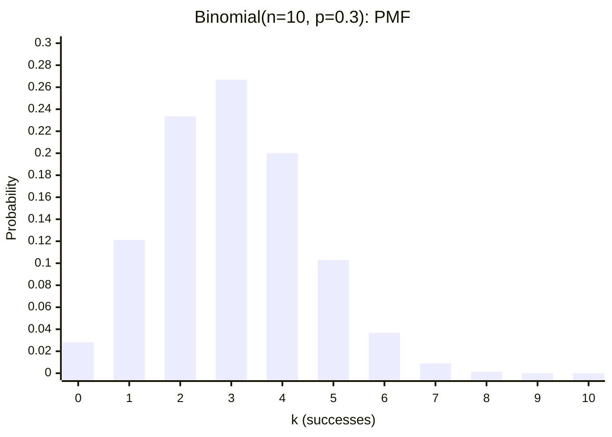

# GATE DA · Day 2 of 20
## Probability II: random variables, expectation, discrete distributions, joint distributions, covariance

*About a 30-minute read. Answers to the practice and recall questions are in the collapsible section at the bottom.*

---

## 1. How GATE asks this

This is the core of the Probability & Statistics section. Expect 2–4 questions per paper from today's material:
- **NAT:** find the constant k that makes a PDF valid, E[X], Var(X), a binomial or Poisson probability, or Cov(X, Y) from a joint table.
- **MSQ:** which statements about expectation, variance, covariance or independence are *always* true. The classic trap is "zero covariance ⇒ independent".
- **MCQ:** recognising which distribution a story describes, and the law of total expectation.

Most of the marks come from knowing which formula to use. The calculations are usually short.

---

## 2. The ideas from zero

### 2.1 Random variables

A **random variable (RV)** X is just a rule that turns each outcome into a number. Toss 3 coins and let X = number of heads. The outcome HTH becomes 2.

- **Discrete RV:** takes countable values (0, 1, 2, …). It's described by a **PMF**.
- **Continuous RV:** takes values in an interval. It's described by a **PDF**.

### 2.2 PMF, PDF, CDF

**PMF (discrete):** p(x) = P(X = x).
- p(x) ≥ 0 and Σ p(x) = 1.

**PDF (continuous):** f(x) with f(x) ≥ 0 and ∫ f(x) dx = 1 over all x.
- Probabilities are **areas**: P(a ≤ X ≤ b) = ∫ₐᵇ f(x) dx.
- P(X = a) = 0 for any single point. So ≤ and < give the same probability.
- f(x) itself is a **density, not a probability.** It can be bigger than 1. For example, f(x) = 2 on [0, ½].

**CDF (both kinds):** F(x) = P(X ≤ x).
- It never decreases, F(−∞) = 0, F(+∞) = 1, and it's right-continuous.
- Discrete case: F is a **staircase**, and the jump at x equals p(x).
- Continuous case: F is smooth, with **f(x) = F′(x)** and F(x) = ∫₋∞ˣ f(t) dt.
- P(a < X ≤ b) = F(b) − F(a) always.
- P(X > a) = 1 − F(a).

**Going between them**
- PMF → CDF: running sum.
- CDF → PMF: jump sizes.
- PDF → CDF: integrate.
- CDF → PDF: differentiate.

**"Find k" questions:** set the total probability to 1 and solve. For example, f(x) = kx² on [0, 2]: k·(8/3) = 1, so k = 3/8.

### 2.3 Expectation (mean)

**E[X] = Σ x·p(x)** (discrete) or **∫ x·f(x) dx** (continuous). It's the long-run average, or the balance point of the distribution.

**Function of X (LOTUS):** E[g(X)] = Σ g(x)p(x) or ∫ g(x)f(x)dx. You don't need the distribution of g(X).

**Linearity, the most useful fact in probability:**
- E[aX + b] = aE[X] + b.
- **E[X + Y] = E[X] + E[Y] always**, even if X and Y are dependent.
- Indicator trick: write a count as a sum of 0/1 indicators. The expected count is then the sum of the probabilities. Example: the expected number of people who get their own hat back is n·(1/n) = 1, for any n.

**Products need independence:** E[XY] = E[X]E[Y] holds if X, Y are independent (more generally, if they're uncorrelated). It's not true in general.

**In general E[g(X)] ≠ g(E[X]).** For example, E[X²] ≥ (E[X])², and E[1/X] ≠ 1/E[X].

### 2.4 Variance and standard deviation

**Var(X) = E[(X − μ)²] = E[X²] − (E[X])².** The second form is the one to compute with.
- **SD:** σ = √Var(X), in the same units as X.
- Var(X) ≥ 0, and it equals 0 only if X is a constant.
- **Var(aX + b) = a²·Var(X).** Shifting by b doesn't change the spread. Note Var(−X) = Var(X).
- **Var(X + Y) = Var(X) + Var(Y) + 2Cov(X, Y).**
- **Var(X − Y) = Var(X) + Var(Y) − 2Cov(X, Y).** With independence, the variance still **adds**, even for a difference.
- **Independent case:** Var(X ± Y) = Var(X) + Var(Y). For a sum of n independent copies, Var = n·σ², so the SD grows like √n.
- **Average of n i.i.d. values:** Var(X̄) = σ²/n. This drives the CLT on Day 3.

### 2.5 Mean, median, mode, SD

**Of data x₁…xₙ:**
- Mean x̄ = Σxᵢ/n.
- Median = the middle value after sorting. For even n, average the two middle ones.
- Mode = the most frequent value.
- Population SD divides by n. **Sample SD divides by n − 1** (Bessel's correction, which makes s² unbiased). Read which one the question wants.

**Of a distribution:**
- Mean = E[X].
- Median m: F(m) = ½.
- Mode = where p(x) or f(x) peaks.

**Skew:**
- Symmetric: mean = median = mode.
- Right-skewed (long right tail, like incomes): mode < median < mean. The mean gets dragged towards the tail.

**Effect of transforms on data:**
- Adding a constant shifts the mean, median and mode, but leaves the SD and variance unchanged.
- Multiplying by c scales the mean and the SD by c (|c| for SD), and the variance by c².

### 2.6 The discrete distributions in the syllabus

**Discrete uniform on {a, …, b}** (n = b − a + 1 values)
- p = 1/n each.
- Mean = (a+b)/2.
- Var = (n² − 1)/12.
- A fair die: mean 3.5, Var 35/12 ≈ 2.92.

**Bernoulli(p):** one trial, X = 1 (success) with probability p, else 0.
- Mean p, Var p(1 − p).
- The variance is largest at p = ½, where it's ¼.

**Binomial(n, p):** the number of successes in n **independent** trials, each with the **same** p.
- P(X = k) = C(n,k)·pᵏ·(1−p)ⁿ⁻ᵏ, for k = 0…n.
- **Mean np, Var np(1−p).** It's a sum of n Bernoullis, so the variances add.
- Mode ≈ ⌊(n+1)p⌋.
- **Use it when** you have a fixed n, two outcomes, independence and a constant p. Sampling *without* replacement from a small population breaks this (that's hypergeometric).
- "Given mean and variance, find n and p": 1 − p = Var/mean, then n = mean/p.

The PMF of Bin(10, 0.3), the distribution in Example 3:

It peaks at k = 3, which is the mode ⌊(n+1)p⌋ = ⌊3.3⌋ = 3, and it has a longer right tail. The CDF is a staircase that climbs by each bar's height: F(2) = 0.028 + 0.121 + 0.234 ≈ 0.383.

**Poisson(λ):** counts of rare events in a fixed interval (calls per hour, typos per page, server errors per day).
- P(X = k) = e^(−λ)·λᵏ/k!, for k = 0, 1, 2, …
- **Mean = Var = λ.** "Mean equals variance" is a hint to use Poisson.
- **Rates scale:** 3 per hour gives λ = 6 for 2 hours.
- **Sum of independent Poissons is Poisson:** Poisson(λ₁) + Poisson(λ₂) = Poisson(λ₁ + λ₂).
- **Poisson as the limit of binomial:** if n is large, p is small and np = λ is moderate, then Bin(n, p) ≈ Poisson(λ = np). Rule of thumb: n ≥ 20 and p ≤ 0.05. GATE often says "n = 1000, p = 0.002" and expects λ = 2.
- Recursion: P(k+1) = P(k)·λ/(k+1). Handy on the virtual calculator.

### 2.7 Joint, marginal and conditional distributions

**Discrete, from a table:**
- **Joint PMF:** p(x, y) = P(X = x, Y = y). All cells sum to 1.
- **Marginal:** pₓ(x) = Σ_y p(x, y) (sum across the row), and the same for Y with column sums.
- **Conditional:** p(y | x) = p(x, y) / pₓ(x). Take X's row and rescale it to sum to 1.
- **Independence:** p(x, y) = pₓ(x)·p_y(y) for **every** cell. One failing cell is enough to break it.

**Continuous:**
- **Joint PDF:** f(x, y) with ∬ f = 1, and P((X,Y) ∈ region) = ∬ over that region.
- **Marginal:** fₓ(x) = ∫ f(x, y) dy. Integrate out the other variable.
- **Conditional PDF:** f(y | x) = f(x, y) / fₓ(x), where fₓ(x) > 0.
- **Independence:** f(x, y) = fₓ(x)·f_y(y). Quick test: the support must be a **rectangle** and f must factor into (x part)·(y part). A triangular support like 0 < y < x < 1 means they're **not** independent, whatever the formula looks like.

### 2.8 Conditional expectation and variance

- **E[Y | X = x] = Σ y·p(y|x)** or ∫ y·f(y|x) dy. It's a number for each x.
- **E[Y | X]** is a **random variable**: it's a function of X.
- **Law of total expectation (tower rule):** **E[Y] = E[ E[Y | X] ].** Average the conditional means, weighted by how likely each X is. This is the expectation version of the total probability rule.
- **Law of total variance:** **Var(Y) = E[ Var(Y | X) ] + Var( E[Y | X] ).**
  - The first term is the average spread *within* groups.
  - The second term is the spread *between* group means. It's the same split ANOVA uses.
- The conditional variance itself: Var(Y | X = x) = E[Y² | X=x] − (E[Y | X=x])².

### 2.9 Covariance and correlation

**Cov(X, Y) = E[(X − μₓ)(Y − μ_y)] = E[XY] − E[X]E[Y].**
- Positive: they tend to move together. Negative: they move opposite ways.
- Cov(X, X) = Var(X), and Cov(X, Y) = Cov(Y, X).
- **Bilinear:** Cov(aX + b, cY + d) = ac·Cov(X, Y). Constants drop out.
- Cov(X + Y, Z) = Cov(X, Z) + Cov(Y, Z).

**Correlation:** **ρ = Cov(X, Y) / (σₓσ_y)**, which is unit-free.
- **−1 ≤ ρ ≤ 1** (from Cauchy–Schwarz).
- |ρ| = 1 if and only if Y = aX + b exactly. ρ = 1 when a > 0, and ρ = −1 when a < 0.
- ρ(aX+b, cY+d) = ±ρ(X, Y). The sign flips only if ac < 0.

**Independence vs zero correlation:**
- Independent ⇒ Cov = 0 (uncorrelated).
- **Cov = 0 does NOT imply independent.** Correlation only measures **linear** dependence.
- Classic counterexample: X uniform on {−1, 0, 1} and Y = X². Y is completely determined by X, yet Cov = E[X³] − E[X]E[X²] = 0 − 0 = 0.
- (For jointly normal variables, zero correlation *does* imply independence. That's a special case, not the rule.)

---

## 3. Worked examples

**Example 1: PMF → mean, variance, CDF (NAT)**
*X takes the values 0, 1, 2, 3 with probabilities 0.1, 0.3, 0.4, 0.2. Find E[X], Var(X), Var(2X − 3) and F(1.5).*

- E[X] = 0(0.1) + 1(0.3) + 2(0.4) + 3(0.2) = **1.7**.
- E[X²] = 0 + 0.3 + 1.6 + 1.8 = 3.7.
- Var(X) = 3.7 − 1.7² = 3.7 − 2.89 = **0.81**.
- Var(2X − 3) = 4 × 0.81 = **3.24**. The −3 drops out.
- F(1.5) = P(X ≤ 1.5) = P(0) + P(1) = **0.4**. A CDF between jumps stays flat.

**Example 2: PDF → k, mean, variance, median (NAT)**
*f(x) = kx² on [0, 2], and 0 elsewhere.*

- **k:** ∫₀² kx² dx = k·8/3 = 1, so **k = 3/8**.
- **CDF:** F(x) = ∫₀ˣ (3/8)t² dt = **x³/8** on [0, 2].
- **Mean:** E[X] = ∫₀² x·(3/8)x² dx = (3/8)(x⁴/4)|₀² = (3/8)(4) = **1.5**.
- **E[X²]** = ∫₀² (3/8)x⁴ dx = (3/8)(32/5) = 2.4.
- **Var** = 2.4 − 2.25 = **0.15**.
- **Median:** F(m) = m³/8 = ½, so m³ = 4 and **m = 4^(1/3) ≈ 1.587**.
- **Mode:** f is increasing on [0, 2], so the mode is **2** (the right end).
- Check: mean 1.5 < median 1.587 < mode 2. The distribution is left-skewed, so the mean is pulled towards the long left tail. ✓

**Example 3: binomial (NAT)**
*A quiz has 10 independent MCQs. Each is answered right with probability 0.3 by guessing. Find P(exactly 2 right), P(at least 1 right), the mean and the variance.*

- P(X = 2) = C(10,2)(0.3)²(0.7)⁸ = 45 × 0.09 × 0.05765 ≈ **0.2335**.
- P(X ≥ 1) = 1 − 0.7¹⁰ = 1 − 0.0282 ≈ **0.9718**.
- Mean = np = **3**. Var = np(1 − p) = 10 × 0.3 × 0.7 = **2.1**.

**Example 4: Poisson as the limit of binomial (NAT)**
*A server request fails with probability 0.002, independently. Out of 1000 requests, find P(at most 1 failure).*

- n is large and p is small, so use Poisson with λ = np = **2**.
- P(X ≤ 1) = e⁻²(1 + 2) = 3e⁻² ≈ **0.4060**.
- The exact binomial gives 0.4057, so the approximation is off by only 0.0003. ✓

**Example 5: joint table → marginals, conditional, covariance, correlation (NAT/MSQ)**

| | Y = 0 | Y = 1 |
|---|---|---|
| X = 0 | 0.2 | 0.3 |
| X = 1 | 0.1 | 0.4 |

- **Marginals:**
  - X: P(X=0) = 0.5 (row sum), P(X=1) = 0.5.
  - Y: P(Y=0) = 0.3 (column sum), P(Y=1) = 0.7.
- **Independent?** P(0,0) = 0.2, but P(X=0)P(Y=0) = 0.15. **No.** One cell is enough.
- **Conditional:** P(Y=1 | X=1) = 0.4/0.5 = **0.8**.
- **Conditional mean:** E[Y | X=0] = 0.3/0.5 = **0.6**, and E[Y | X=1] = 0.8.
  - Tower check: E[Y] = 0.5(0.6) + 0.5(0.8) = 0.7. ✓
- **Covariance:**
  - E[X] = 0.5 and E[Y] = 0.7.
  - E[XY] = P(X=1, Y=1) = 0.4, since that's the only nonzero product.
  - Cov = 0.4 − 0.35 = **0.05**.
- **Correlation:**
  - Var(X) = 0.5 × 0.5 = 0.25 and Var(Y) = 0.7 × 0.3 = 0.21. Both are Bernoulli.
  - ρ = 0.05/√(0.25 × 0.21) = 0.05/0.2291 ≈ **0.218**.

**Example 6: zero covariance, but dependent (MSQ classic)**
*X is uniform on {−1, 0, 1} and Y = X².*

- E[X] = 0.
- E[XY] = E[X³] = (−1 + 0 + 1)/3 = 0.
- Cov = 0 − 0·E[Y] = **0**.
- But P(Y=0 | X=0) = 1 while P(Y=0) = 1/3. So they're **dependent**.
- Takeaway: zero correlation only rules out a **linear** relationship.

**Example 7: law of total expectation and variance (NAT)**
*A fair coin decides X = 2 or X = 4. Then Y = number of heads in X fair tosses, so Y | X ~ Bin(X, ½). Find E[Y] and Var(Y).*

- E[Y | X] = X/2, so **E[Y] = E[X]/2 = 3/2 = 1.5**.
- Var(Y | X) = X·½·½ = X/4, so E[Var(Y | X)] = E[X]/4 = 3/4 = 0.75.
- Var(E[Y | X]) = Var(X/2) = Var(X)/4. Var(X) for {2, 4} is 1, so this is 0.25.
- **Var(Y) = 0.75 + 0.25 = 1.0.**
- Checked against a direct enumeration of every outcome. ✓

**Example 8: data statistics (NAT)**
*Data: 2, 3, 3, 5, 7, 10.*

- Mean = 30/6 = **5**.
- Median = (3 + 5)/2 = **4**.
- Mode = **3**.
- Squared deviations: 9, 4, 4, 0, 4, 25. Their sum is 46.
- **Population** variance = 46/6 ≈ 7.667, so SD ≈ **2.769**.
- **Sample** variance = 46/5 = 9.2, so s ≈ **3.033**.
- Mean > median, so the data is right-skewed (the 10 is the long tail).

---

## 4. Common traps

1. **Var(X − Y) is not Var(X) − Var(Y).** For independent variables it's Var(X) + Var(Y). Variances never subtract.
2. **Var(aX + b) = a²Var(X).** People forget to square, or wrongly add b. Var(−3X) = 9Var(X).
3. **Cov = 0 ⇒ independent is FALSE.** Independent ⇒ Cov = 0 is TRUE. MSQs test both directions.
4. **E[XY] = E[X]E[Y] needs independence** (or zero covariance). E[X + Y] = E[X] + E[Y] needs nothing.
5. **A PDF value isn't a probability.** f(x) can be greater than 1, and P(X = a) = 0 for continuous X.
6. **A CDF at a non-integer point for a discrete RV:** F(2.7) = F(2). Watch < vs ≤ for discrete RVs, since P(X < 3) = F(2).
7. **Binomial needs independence and a constant p.** Drawing without replacement from a small batch is not binomial.
8. **Poisson λ must match the interval.** A rate of 3 per hour over 20 minutes gives λ = 1.
9. **Sample vs population SD.** Use n − 1 for the sample. If the question says "sample standard deviation", use n − 1.
10. **Joint independence with non-rectangular support.** f(x, y) = 2 on 0 < y < x < 1 looks constant, but X and Y are not independent.
11. **E[1/X] ≠ 1/E[X], and E[X²] ≠ (E[X])².** The gap between the last two is exactly the variance.

---

## 5. Cheat card

**Basics**
- PMF sums to 1. PDF integrates to 1. F(x) = P(X ≤ x). f = F′. P(a < X ≤ b) = F(b) − F(a).
- E[X] = Σx p(x) or ∫x f(x)dx. E[g(X)] = Σ g(x) p(x).
- E[aX + b] = aE[X] + b. E[X + Y] = E[X] + E[Y] always.
- Var = E[X²] − (E[X])². Var(aX + b) = a²Var(X).
- Var(X ± Y) = Var X + Var Y ± 2Cov. Var(X̄) = σ²/n.

**Distributions**

| Distribution | PMF | Mean | Var |
|---|---|---|---|
| Uniform{a..b} | 1/n | (a+b)/2 | (n²−1)/12 |
| Bernoulli(p) | p or 1−p | p | p(1−p) |
| Bin(n, p) | C(n,k)pᵏ(1−p)ⁿ⁻ᵏ | np | np(1−p) |
| Poisson(λ) | e^(−λ)λᵏ/k! | λ | λ |

- Bin → Poisson when n is large and p is small, with λ = np.
- Poisson + Poisson = Poisson(λ₁ + λ₂).

**Joint and conditional**
- Marginal = sum (or integrate) out the other variable.
- Conditional = joint / marginal.
- Independent ⇔ joint = product of marginals, at every point.
- **Tower rule:** E[Y] = E[E[Y | X]].
- **Total variance:** Var(Y) = E[Var(Y|X)] + Var(E[Y|X]).

**Covariance and correlation**
- Cov = E[XY] − E[X]E[Y]. Cov(aX+b, cY+d) = ac·Cov.
- ρ = Cov/(σₓσ_y), and −1 ≤ ρ ≤ 1. |ρ| = 1 ⇔ an exact linear relationship.
- Independent ⇒ ρ = 0, but not the other way round.

---

## 6. Practice

**Q1 (NAT).** X ~ Binomial(n, p) has mean 4 and variance 2.4. Find n.

**Q2 (NAT, 2 decimals).** X has PDF f(x) = c(1 − x²) on [−1, 1], and 0 elsewhere. Find E[X²].

**Q3 (MSQ).** X and Y are random variables with finite variances. Which of these are ALWAYS true?
(a) E[XY] = E[X]·E[Y]
(b) If X and Y are independent, Var(X + Y) = Var(X) + Var(Y)
(c) If Cov(X, Y) = 0, then X and Y are independent
(d) Var(3 − 2X) = 4·Var(X)

**Q4 (NAT, 3 decimals).** Calls arrive at a help desk as a Poisson process at an average of 3 per hour. Find P(exactly 2 calls in a given hour).

**Q5 (NAT, 2 decimals).** Find Cov(X, Y) for this joint PMF:

| | Y = 1 | Y = 2 |
|---|---|---|
| X = 1 | 0.3 | 0.2 |
| X = 2 | 0.1 | 0.4 |

**Q6 (MCQ).** X is the outcome of one roll of a fair six-sided die. Var(X) is:
(a) 3.5  (b) 2.92  (c) 1.71  (d) 17.5

### Recall: Day 1

**R1.** How many non-negative integer solutions does x₁ + x₂ + x₃ + x₄ = 5 have?

**R2.** A and B are mutually exclusive, and both have positive probability. Can they be independent?

**R3.** P(disease) = 0.1. The test catches 90% of the sick and gives false positives for 10% of the healthy. What is P(disease | +)?

---

**Next, Day 3:** continuous distributions (uniform, exponential, normal, t, chi-squared), the central limit theorem, confidence intervals, and z, t and chi-squared tests.

---

<b>Answers</b> (click to open)

**Q1: 10.**
- 1 − p = Var/mean = 2.4/4 = 0.6, so p = 0.4.
- n = 4/0.4 = 10.

**Q2: 0.20.**
- Find c: c·∫₋₁¹(1 − x²)dx = c·(4/3) = 1, so c = 3/4.
- E[X²] = (3/4)∫₋₁¹(x² − x⁴)dx = (3/4)(2/3 − 2/5) = (3/4)(4/15) = 1/5.

**Q3: (b), (d).**
- (a) needs independence (or zero covariance).
- (c) is the classic false converse, e.g. Y = X² with X symmetric.
- (d) holds because Var(aX + b) = a²Var(X), and (−2)² = 4.

**Q4: 0.224.** P(X = 2) = e⁻³·3²/2! = 4.5e⁻³ ≈ 0.2240.

**Q5: 0.10.**
- E[X] = 1(0.5) + 2(0.5) = 1.5.
- E[Y] = 1(0.4) + 2(0.6) = 1.6.
- E[XY] = 1(0.3) + 2(0.2) + 2(0.1) + 4(0.4) = 2.5.
- Cov = 2.5 − 2.4 = 0.1.

**Q6: (b).**
- E[X²] = 91/6 and E[X] = 3.5.
- Var = 91/6 − 12.25 = 35/12 ≈ 2.92.
- It also matches the uniform formula (n² − 1)/12 = 35/12.
- (c) 1.71 is the trap: that's the SD, √2.92.

**Recall**
- **R1:** C(5+4−1, 3) = C(8, 3) = 56.
- **R2:** No. P(A∩B) = 0, but P(A)P(B) > 0.
- **R3:** 0.09/(0.09 + 0.09) = 0.5.

