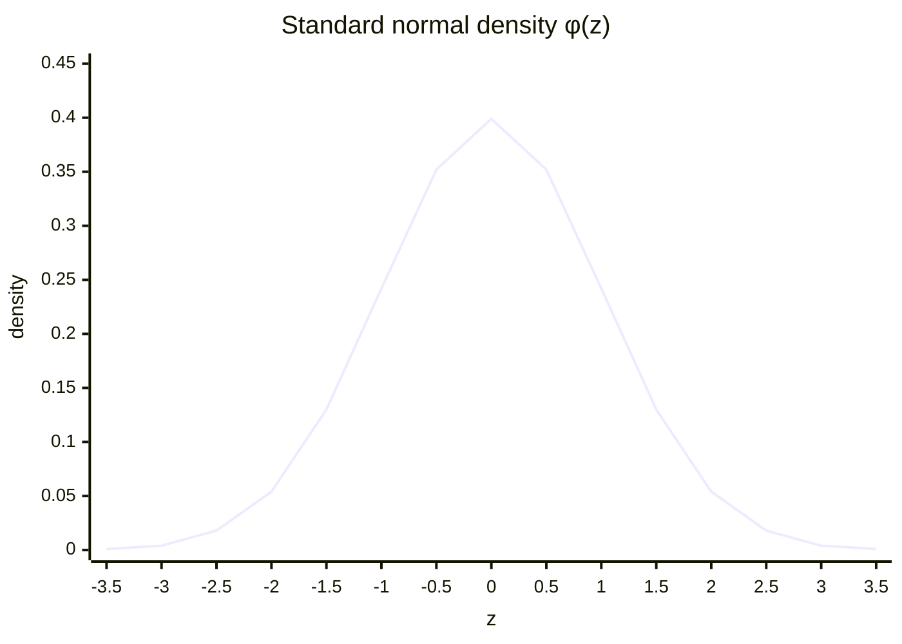

# GATE DA · Day 3 of 20
## Statistics: continuous distributions, CLT, confidence intervals, hypothesis tests

*About a 30-minute read. Answers to the practice and recall questions are in the collapsible section at the bottom.*

---

## 1. How GATE asks this

This is the statistics half of the Probability & Statistics section. Typical questions:
- **NAT:** a normal or exponential probability, the length or limits of a confidence interval, or a test statistic (z, t, χ²) from given numbers.
- **MSQ:** true/false statements about p-values, Type I/II errors, CI interpretation, or the shapes of t and χ².
- **MCQ:** "which test applies here?" (z vs t, paired vs two-sample, goodness of fit vs independence), plus memorylessness.

You get a **virtual calculator but no z or t tables**. So questions either give you the critical values or expect you to know a handful by heart. Learn the key z values in 2.4.

---

## 2. The ideas from zero

### 2.1 Continuous uniform U(a, b)

Every point in [a, b] is equally likely.

- f(x) = 1/(b − a) on [a, b], and 0 elsewhere.
- F(x) = (x − a)/(b − a).
- **Mean (a+b)/2. Variance (b − a)²/12.**
- P(c < X < d) = (d − c)/(b − a), just the length ratio.
- Uniform on (0, 1): mean ½, variance 1/12.

### 2.2 Exponential(λ): waiting time until the next event

If events arrive as a Poisson process at rate λ per unit time, the gap between arrivals is Exponential(λ).

- f(x) = λe^(−λx) for x ≥ 0.
- **Survival function:** P(X > x) = e^(−λx). Memorise this one; most questions use it directly.
- F(x) = 1 − e^(−λx).
- **Mean 1/λ. Variance 1/λ². SD 1/λ** (SD equals the mean).
- **Median = ln 2 / λ ≈ 0.693/λ**, which is below the mean. The distribution is right-skewed.
- Watch the parametrisation. If you're told "mean 4 minutes", then λ = 1/4.

**Memoryless property.** This is the only continuous distribution with it:

**P(X > s + t | X > s) = P(X > t).**

A bulb that has already lasted 1000 hours is "as good as new". The time already waited tells you nothing about the remaining wait. Proof: e^(−λ(s+t)) / e^(−λs) = e^(−λt). (Its discrete cousin, the geometric distribution, is also memoryless.)

**Poisson–exponential link:** P(no event in time t) = P(Poisson count = 0) = e^(−λt) = P(wait > t). It's the same fact seen from two sides.

### 2.3 Normal N(μ, σ²)

The bell curve. It's symmetric around μ, and the mean, median and mode are all μ.

- f(x) = (1/(σ√(2π))) · e^(−(x−μ)²/(2σ²)).
- **Standardise:** Z = (X − μ)/σ ~ N(0, 1). Every normal question becomes a question about Z.
- Φ(z) = P(Z ≤ z).
  - Φ(0) = 0.5.
  - **Φ(−z) = 1 − Φ(z)** (symmetry).
  - P(|Z| > z) = 2(1 − Φ(z)).
- **Linear combinations stay normal:** if X ~ N(μ, σ²), then aX + b ~ N(aμ + b, a²σ²).
- **Independent normals add:** X + Y ~ N(μ₁ + μ₂, σ₁² + σ₂²). The same goes for X − Y: the means subtract but the variances **still add**.
- **Inflection points** at μ ± σ.

The standard normal density φ(z):

For a **two-tailed test at 5%**, the middle 95% (between z = −1.96 and +1.96) is where you **keep H₀**. The 2.5% tail beyond each of ±1.96 is the **rejection region**. Every two-tailed z-test at 5% is this picture.

### 2.4 The numbers to memorise

**The 68–95–99.7 rule:** about 68.3% of the mass lies within 1σ of μ, 95.4% within 2σ, and 99.7% within 3σ.

**Key critical values:**

| Confidence | Two-tailed z | One-tailed z |
|---|---|---|
| 90% | 1.645 | 1.282 |
| 95% | **1.96** | **1.645** |
| 99% | **2.576** | **2.326** (≈ 2.33) |

**Useful Φ values:**
- Φ(1) ≈ 0.8413
- Φ(1.5) ≈ 0.9332
- Φ(2) ≈ 0.9772
- Φ(2.5) ≈ 0.9938
- Φ(3) ≈ 0.9987

So P(Z > 1) ≈ 0.159, P(Z > 2) ≈ 0.023, and P(Z > 1.5) ≈ 0.067.

### 2.5 Chi-squared and t distributions

**Chi-squared χ²ₖ:** add up the squares of k independent standard normals. So χ²ₖ = Z₁² + … + Zₖ².
- Takes only positive values and is right-skewed.
- **Mean k, variance 2k.**
- Gets more symmetric as k grows.
- Where it appears:
  1. (n − 1)s²/σ² ~ χ²ₙ₋₁. This is used for tests and CIs on a variance.
  2. χ² tests on counts (2.9).
- It's additive: χ²ₐ + χ²_b = χ²ₐ₊_b for independent terms.

**Student's t with ν degrees of freedom:** t = Z / √(V/ν), where Z ~ N(0,1) and V ~ χ²ᵥ are independent.
- Symmetric around 0, bell-shaped, with **heavier tails than the normal**.
- **Approaches N(0, 1) as ν → ∞.** By ν ≈ 30 it's very close.
- Mean 0 (for ν > 1). Variance ν/(ν − 2) > 1 (for ν > 2).
- **It appears when you standardise a sample mean using s instead of σ:**
  - (X̄ − μ) / (s/√n) ~ tₙ₋₁, when the population is normal.
  - The heavier tails pay for the extra uncertainty of estimating σ. So t critical values are larger than z values: t₀.₀₂₅,₂₄ ≈ 2.064 vs 1.96, and t₀.₀₂₅,₄ ≈ 2.776.

### 2.6 Sampling distribution and the CLT

Take n i.i.d. draws with mean μ and variance σ².

- **E[X̄] = μ.** The sample mean is unbiased.
- **Var(X̄) = σ²/n.** The **standard error** is **SE = σ/√n**.
  - To halve the SE you need **4×** the sample size.
- **Central limit theorem:** for large n (rule of thumb n ≥ 30), **X̄ ≈ N(μ, σ²/n)** whatever the shape of the original population.
  - Equivalently, the sum Σ Xᵢ ≈ N(nμ, nσ²).
  - If the population is already normal, this holds exactly for every n.
- **Normal approximation to the binomial:** Bin(n, p) ≈ N(np, np(1−p)) when np and n(1−p) are both at least about 10.
  - Continuity correction: P(X ≤ k) ≈ Φ((k + 0.5 − np)/√(np(1−p))).
- **Typical GATE use:** "a population has mean 50 and SD 12; n = 36; find P(X̄ > 53)". Here SE = 12/6 = 2, z = 1.5, and the answer is ≈ 0.067.

### 2.7 Confidence intervals

A CI is a range built from the data so that, over many repeated samples, it captures the true parameter a stated share of the time (for example, 95%).

**For the mean:**
- **σ known** (or n large): **x̄ ± z_(α/2) · σ/√n**.
- **σ unknown, normal population, small n:** **x̄ ± t_(α/2, n−1) · s/√n**.
- **Half-width (margin of error):** E = z·σ/√n.
- **Width:** 2E.
- **Sample size for a target margin:** n = (z·σ/E)², rounded **up**.

**What changes the width:**
- Higher confidence → wider.
- Larger n → narrower (by √n).
- Larger σ → wider.

**Correct interpretation:** the *method* captures μ 95% of the time. It is **not** "there is a 95% probability that μ lies in this particular interval". In the frequentist view μ is fixed; it's the interval that's random.

**Link to tests:** a two-sided (1 − α) CI excludes μ₀ **exactly when** the two-tailed test at level α rejects H₀: μ = μ₀.

### 2.8 Hypothesis testing basics

**The setup:**
- **H₀ (null):** the default or "no effect" claim. It always contains the equality, for example μ = 500.
- **H₁ (alternative):** what you want evidence for. It is μ ≠ 500 (two-tailed), μ > 500 (right-tailed) or μ < 500 (left-tailed).
- **Test statistic:** how many standard errors the estimate sits from the H₀ value. For example, z = (x̄ − μ₀)/(σ/√n).
- **Significance level α:** the Type I error rate you're willing to accept, usually 0.05.
- **Rejection region:** for a two-tailed test, |z| > z_(α/2) (that's 1.96 at 5%). For a right-tailed test, z > z_α (that's 1.645 at 5%).

**p-value:** the probability, **assuming H₀ is true**, of getting a test statistic at least as extreme as the one observed.
- **Reject H₀ if p ≤ α.**
- For a two-tailed test, p = 2·P(Z > |z_obs|).
- The p-value is **not** the probability that H₀ is true.

**Errors:**

| | H₀ true | H₀ false |
|---|---|---|
| Reject H₀ | **Type I** (α) | Correct (power = 1 − β) |
| Keep H₀ | Correct | **Type II** (β) |

- Type I is a false alarm. Type II is a missed effect.
- With n fixed, **lowering α raises β.** The only way to reduce both is to increase n.
- **Power** = 1 − β. It increases with n, with the true effect size, and with α, and it decreases as σ grows.
- "Fail to reject H₀" ≠ "accept H₀ as proven". It just means there isn't enough evidence.

### 2.9 Which test? z, t and χ²

**z-test (mean, σ known or n large):** z = (x̄ − μ₀)/(σ/√n).
- Two means, σ's known: z = (x̄₁ − x̄₂)/√(σ₁²/n₁ + σ₂²/n₂).
- Proportion: z = (p̂ − p₀)/√(p₀(1−p₀)/n).

**One-sample t-test (σ unknown):** t = (x̄ − μ₀)/(s/√n), with df = n − 1.

**Two-sample (independent) t-test:**
- Pooled version, assuming equal variances:
  - s_p² = [(n₁−1)s₁² + (n₂−1)s₂²]/(n₁ + n₂ − 2)
  - t = (x̄₁ − x̄₂)/(s_p√(1/n₁ + 1/n₂))
  - df = n₁ + n₂ − 2
- Welch's version, for unequal variances: SE = √(s₁²/n₁ + s₂²/n₂). The df uses a messier formula.

**Paired t-test:** the same subjects are measured twice (before/after, left/right).
- Take the differences dᵢ, then run a **one-sample** t-test on them: t = d̄/(s_d/√n), df = n − 1.
- Pairing removes the variation between subjects, so it's usually more powerful than a two-sample test.
- Using a two-sample test on paired data is a classic mistake.

**χ² goodness of fit:** do the observed counts match a claimed distribution?
- χ² = Σ (O − E)²/E.
- **df = (number of categories) − 1 − (number of parameters estimated from the data).**
- Each expected count E should be at least about 5.
- Always right-tailed: reject if χ² > the critical value.

**χ² test of independence:** an r × c contingency table.
- Expected count for each cell: **Eᵢⱼ = (row total × column total)/grand total.**
- χ² = Σ (O − E)²/E, with **df = (r − 1)(c − 1).**
- Large values mean the two variables are related.

**Decision guide:**
- One mean, σ known (or large n) → z.
- One mean, σ unknown, small n → t (df n − 1).
- Two independent groups → two-sample t.
- Same subjects measured twice → paired t.
- Counts vs a claimed distribution → χ² goodness of fit.
- Two categorical variables in a table → χ² independence.
- One variance → χ² with (n−1)s²/σ₀².

---

## 3. Worked examples

**Example 1: exponential and memorylessness (NAT)**
*Bulb lifetimes are exponential with mean 1000 hours. Find (a) P(a bulb lasts more than 1500 h), (b) P(it lasts more than 2500 h, given it has already lasted 1000 h), and (c) the median lifetime.*

- λ = 1/1000.
- (a) P(X > 1500) = e^(−1.5) ≈ **0.2231**.
- (b) Memoryless: P(X > 2500 | X > 1000) = P(X > 1500) = **0.2231**. The 1000 hours already used don't matter.
- (c) Median = ln 2 / λ = 0.6931 × 1000 ≈ **693.1 h**.
  - It's below the 1000 h mean because the right tail is long. Half of all bulbs die before 693 h.

**Example 2: normal probabilities (NAT)**
*Exam marks are N(60, 10²). Find P(mark > 75) and P(50 < mark < 80).*

- P(X > 75): z = (75 − 60)/10 = 1.5, so P = 1 − Φ(1.5) ≈ **0.0668**.
- P(50 < X < 80): convert both ends to z = −1 and z = 2.
  - Φ(2) − Φ(−1) = 0.9772 − (1 − 0.8413) = 0.9772 − 0.1587 ≈ **0.8186**.

**Example 3: CLT (MCQ)**
*A population has mean 50 and SD 12 (shape unknown). A random sample of 36 is taken. Find P(X̄ > 53).*

- n = 36 is large enough for the CLT, so X̄ ≈ N(50, (12/√36)²) = N(50, 2²).
- z = (53 − 50)/2 = 1.5, so P ≈ **0.0668**.
- The same z as Example 2. The SE (2), not the population SD (12), is what scales the mean.

**Example 4: confidence intervals, z vs t (NAT)**
*A sample of n = 25 has x̄ = 72 and s = 10. The population is normal. Build a 95% CI for μ. Use t₀.₀₂₅,₂₄ = 2.064.*

- σ is unknown and n is small, so use **t**.
- SE = 10/√25 = 2.
- 72 ± 2.064 × 2 = 72 ± 4.128 → **(67.87, 76.13)**.
- If σ = 10 were *known*: 72 ± 1.96 × 2 = 72 ± 3.92 → (68.08, 75.92).
  - The t interval is wider because estimating σ adds uncertainty.

**Example 5: one-sample z-test with a p-value (NAT/MCQ)**
*A packet claims a mean of 500 g, and σ = 15 g is known. A sample of 36 packets averages 495 g. Test at α = 0.05, two-tailed.*

- H₀: μ = 500 vs H₁: μ ≠ 500.
- SE = 15/6 = 2.5, so z = (495 − 500)/2.5 = **−2.0**.
- |z| = 2.0 > 1.96, so **reject H₀**.
- p = 2·P(Z > 2) ≈ **0.0455** < 0.05. Same conclusion.
- At α = 0.01 (critical 2.576) you would **not** reject. The decision depends on α.

**Example 6: paired t-test (NAT)**
*5 students' scores before and after a course improve by 2, 4, 1, 3, 5. Test at 5% (two-tailed) whether the course changes scores. Use t₀.₀₂₅,₄ = 2.776.*

- d̄ = 15/5 = 3.
- Squared deviations from 3 are 1, 1, 4, 0, 4, summing to 10. So s_d = √(10/4) = √2.5 ≈ 1.581.
- t = 3/(1.581/√5) = 3/0.7071 ≈ **4.243**, with df = 4.
- 4.243 > 2.776, so **reject H₀**: the course has an effect. (p ≈ 0.013.)

**Example 7: pooled two-sample t-test (NAT)**
*Group A: n = 10, x̄ = 78, s = 6. Group B: n = 10, x̄ = 72, s = 8. Assume equal variances. Use t₀.₀₂₅,₁₈ = 2.101.*

- s_p² = (9·36 + 9·64)/18 = 50, so s_p ≈ 7.071.
- t = (78 − 72)/(7.071·√(0.2)) = 6/3.162 ≈ **1.897**, with df = 18.
- 1.897 < 2.101, so **fail to reject**. A 6-point gap isn't significant with this much spread and n = 10 per group.

**Example 8: χ² goodness of fit (NAT)**
*A die is rolled 60 times. The faces 1–6 come up 8, 12, 9, 11, 6, 14 times. Is it fair, at 5%? Use χ²₀.₀₅,₅ = 11.07.*

- Expected count per face = 10.
- χ² = (4 + 4 + 1 + 1 + 16 + 16)/10 = **4.2**, with df = 6 − 1 = 5.
- 4.2 < 11.07, so **fail to reject**. The die looks fair.

**Example 9: χ² independence, 2×2 (NAT)**
*100 people:*

| | Like | Dislike | Total |
|---|---|---|---|
| Men | 30 | 20 | 50 |
| Women | 20 | 30 | 50 |
| Total | 50 | 50 | 100 |

*Is liking independent of gender? Use χ²₀.₀₅,₁ = 3.841.*

- Every expected count is (50 × 50)/100 = 25.
- Each cell contributes (±5)²/25 = 1, so **χ² = 4.0**, with df = (2−1)(2−1) = 1.
- 4.0 > 3.841, so **reject independence**. (p ≈ 0.046.)
- No Yates continuity correction here. Add it only if the question asks.

---

## 4. Common traps

1. **Exponential parametrisation.** A "mean of 4" means λ = 1/4, so P(X > x) = e^(−x/4). People plug in λ = 4 by mistake.
2. **Memoryless applies only to the exponential** (and the geometric). It does **not** apply to the normal or uniform.
3. **Standard deviation vs standard error.** Use σ for one observation and σ/√n for a sample mean.
4. **Variances add for X − Y too.** Var(X − Y) = σₓ² + σ_y² for independent variables.
5. **z vs t.** Use t when σ is unknown and n is small. With σ known, use z even if n is small (as long as the population is normal).
6. **Paired data needs a paired test.** If the question says "same subjects", "before and after" or "twins", difference first.
7. **χ² degrees of freedom.** Goodness of fit: k − 1 (minus any parameters you estimated). Independence: (r−1)(c−1), not rc − 1.
8. **The p-value is not P(H₀ true),** and a 95% CI does not mean "95% chance μ is inside this interval".
9. **One-tailed vs two-tailed.** At 5%, use 1.645 one-tailed and 1.96 two-tailed. For a two-tailed p-value, double the single tail.
10. **"Fail to reject" ≠ "accept as true".**
11. **Lowering α at a fixed n raises β.** It doesn't make the test "better" in every way.
12. **Sample size rounding.** n = (zσ/E)² is always rounded **up**, never to the nearest integer.

---

## 5. Cheat card

**Distributions**
- **U(a, b):** mean (a+b)/2, variance (b−a)²/12.
- **Exp(λ):** P(X > x) = e^(−λx), mean 1/λ, variance 1/λ², median ln2/λ. Memoryless: P(X > s+t | X > s) = P(X > t).
- **N(μ, σ²):** Z = (X−μ)/σ. Φ(−z) = 1 − Φ(z). 68/95/99.7 within 1/2/3σ.
- **z values:**
  - Two-tailed: 90% → 1.645, 95% → 1.96, 99% → 2.576.
  - One-tailed: 95% → 1.645, 99% → 2.326.
- **Φ values:** Φ(1) = 0.841, Φ(1.5) = 0.933, Φ(2) = 0.977, Φ(3) = 0.9987.
- **χ²ₖ:** sum of k squared Z's. Mean k, variance 2k. (n−1)s²/σ² ~ χ²ₙ₋₁.
- **tᵥ:** heavier tails than Z, tends to Z as ν → ∞. (X̄−μ)/(s/√n) ~ tₙ₋₁.

**Sampling and CIs**
- **CLT:** X̄ ≈ N(μ, σ²/n), SE = σ/√n. Sum ≈ N(nμ, nσ²).
- **CI:** x̄ ± z·σ/√n (σ known) or x̄ ± t·s/√n (σ unknown).
- **Sample size:** n = ⌈(zσ/E)²⌉.

**Tests**
- One-sample z: (x̄−μ₀)/(σ/√n).
- One-sample t: (x̄−μ₀)/(s/√n), df n−1.
- Paired t: d̄/(s_d/√n), df n−1.
- Pooled two-sample t: (x̄₁−x̄₂)/(s_p√(1/n₁+1/n₂)), df n₁+n₂−2.
- **χ² = Σ(O−E)²/E.**
  - Goodness of fit: df = k−1.
  - Independence: Eᵢⱼ = (row × col)/N, df = (r−1)(c−1).
- **Decision:** reject H₀ if p ≤ α. Type I = α, Type II = β, power = 1 − β.
- **CI ↔ test:** a 95% CI that excludes μ₀ ⇔ reject at 5%, two-tailed.

---

## 6. Practice

**Q1 (NAT).** X ~ Uniform(2, 8). Find Var(X).

**Q2 (NAT, 3 decimals).** Waiting time at a counter is exponential with mean 4 minutes. You've already waited 2 minutes. What is the probability that your **total** wait is more than 8 minutes?

**Q3 (MCQ).** IQ scores are N(100, 15²). What fraction of people score above 130?
(a) 0.0013  (b) 0.0228  (c) 0.0456  (d) 0.1587

**Q4 (MSQ).** Which statements are TRUE?
(a) The p-value is the probability that H₀ is true.
(b) For a fixed sample size, lowering α increases the probability of a Type II error.
(c) If a 95% CI for μ does not contain μ₀, then a two-tailed test of H₀: μ = μ₀ at the 5% level rejects H₀.
(d) The t-distribution has heavier tails than N(0, 1) and approaches it as the degrees of freedom grow.

**Q5 (NAT, 2 decimals).** A sample of 64 items has mean 52. The population SD is known to be 8. Find the **upper** limit of the 95% confidence interval for μ.

**Q6 (NAT).** A χ² test of independence is run on a 3 × 4 contingency table. How many degrees of freedom does it have?

### Recall: Day 2

**R1.** Var(X) = 3. What is Var(2X − 5)?

**R2.** n = 100 and p = 0.03. Using the Poisson approximation, what is P(X = 0)?

**R3.** Cov(X, Y) = 0. Must X and Y be independent?

---

**Next, Day 4:** Linear Algebra I. Vector spaces and subspaces, independence, basis, rank and nullity, determinants, systems of equations, Gaussian elimination and LU decomposition.

---

<b>Answers</b> (click to open)

**Q1: 3.** Var = (8 − 2)²/12 = 36/12 = 3.

**Q2: 0.223.**
- Total wait > 8 given you've waited 2 means 6 *more* minutes.
- Memoryless: P(X > 6) = e^(−6/4) = e^(−1.5) ≈ 0.223.

**Q3: (b).**
- z = (130 − 100)/15 = 2, so P(Z > 2) = 1 − 0.9772 ≈ 0.0228.
- (c) 0.0456 is the trap: that's both tails, P(|Z| > 2).

**Q4: (b), (c), (d).**
- (a) is false: the p-value is computed **assuming** H₀ is true. It is not the probability that H₀ is true.
- (b), (c) and (d) are the standard facts from today.

**Q5: 53.96.**
- SE = 8/√64 = 1.
- Upper limit = 52 + 1.96 × 1 = 53.96.

**Q6: 6.** df = (3 − 1)(4 − 1) = 6.

**Recall**
- **R1:** 4 × 3 = 12. The −5 doesn't affect the variance.
- **R2:** λ = np = 3, so P(X = 0) = e⁻³ ≈ 0.0498.
- **R3:** No. Zero covariance only rules out a *linear* relationship (e.g. Y = X² with X symmetric).

