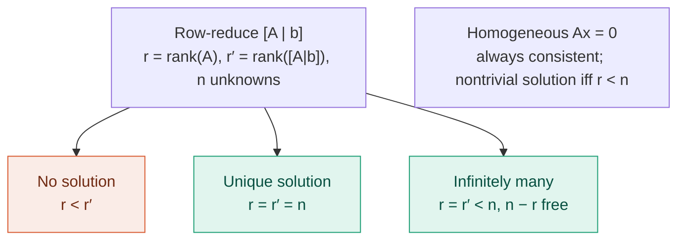

# GATE DA · Day 4 of 20
## Linear Algebra I: vector spaces, independence, rank, determinants, systems of equations, LU

*About a 30-minute read. Answers to the practice and recall questions are in the collapsible section at the bottom. Matrices are written row by row, like [[1, 2], [3, 4]].*

---

## 1. How GATE asks this

Linear algebra is worth about **10 marks** a paper. Today's half (rank, systems, determinants) and Day 5's (eigenvalues, SVD) are tested about equally. Typical questions:
- **NAT:** the rank of a matrix, a determinant, the nullity, or the value of a parameter that gives no or infinitely many solutions.
- **MSQ:** "which of these sets are subspaces?", "which statements about rank or invertibility are true?"
- **MCQ:** solving a small system, or a fact about LU decomposition.

The single most useful skill is **fast row reduction**. Almost everything (rank, independence, solving, the null space) comes down to it.

---

## 2. The ideas from zero

### 2.1 Vector spaces and subspaces

A **vector space** is a set of objects ("vectors") that you can **add** and **scale by numbers**, where the results stay in the set and the usual algebra rules hold (zero vector, negatives, associativity, distributivity…). Examples: ℝⁿ, all m×n matrices, all polynomials of degree ≤ k, all functions on [0, 1].

A **subspace** W of V is a subset that is a vector space in its own right. **The 3-point test:**
1. **The zero vector is in W.** If not, stop: it isn't a subspace. This is the quickest check.
2. **Closed under addition:** u, v ∈ W ⇒ u + v ∈ W.
3. **Closed under scalar multiplication:** u ∈ W, c ∈ ℝ ⇒ cu ∈ W.

Points 2 and 3 together: cu + dv ∈ W for all scalars.

**Subspaces of ℝ³:** {0}, lines through the origin, planes through the origin, and ℝ³ itself. Nothing else.

**Are subspaces:**
- {(x, y, z): x + y + z = 0} (a plane through 0)
- {(x, y, z): x = 2y, z = 0}
- the solution set of any **homogeneous** system Ax = 0
- the span of any set of vectors
- all symmetric n×n matrices
- the polynomials p with p(1) = 0

**Are not subspaces:**
- {x + y + z = 1}: misses 0.
- {(x, y): x ≥ 0}: not closed under scaling by −1.
- {(x, y): xy = 0}, the union of the two axes: (1, 0) + (0, 1) = (1, 1) is not in it.
- {y = x²}: not closed under addition or scaling.
- all **invertible** matrices: no zero matrix, and A + (−A) = 0.
- the solution set of Ax = b with b ≠ 0.

**General rule:** the **intersection** of subspaces is always a subspace. A **union** usually isn't (only when one contains the other). The **sum** U + W = {u + w} is a subspace, with dim(U + W) = dim U + dim W − dim(U ∩ W).

### 2.2 Linear combinations, span, independence

- A **linear combination** of v₁…vₖ is c₁v₁ + … + cₖvₖ.
- The **span** of a set is all of its linear combinations. It's the smallest subspace that contains them.
- **Linearly independent:** the only way to get c₁v₁ + … + cₖvₖ = 0 is with all cᵢ = 0. No vector in the set is a combination of the others.
- **Dependent:** some nontrivial combination gives 0, so at least one vector is redundant.

**Quick facts:**
- Any set containing the **zero vector** is dependent.
- **Two vectors** are dependent ⇔ one is a scalar multiple of the other.
- **More than n vectors in ℝⁿ are always dependent.** For example, 4 vectors in ℝ³.
- n vectors in ℝⁿ are independent ⇔ the matrix with them as columns has **det ≠ 0** ⇔ rank n.
- In general, put the vectors as columns (or rows) of a matrix: **independent ⇔ rank = number of vectors.**

### 2.3 Basis and dimension

- A **basis** is a set that is **independent and spans** the space. It's a minimal spanning set, or equivalently a maximal independent set.
- Every basis of a space has the same size. That size is the **dimension**.

**Common dimensions:**
- ℝⁿ: n.
- Polynomials of degree ≤ k: **k + 1** (basis 1, x, …, xᵏ).
- m×n matrices: mn.
- **Symmetric n×n matrices: n(n+1)/2.**
- **Skew-symmetric n×n: n(n−1)/2.**
- Upper triangular n×n: n(n+1)/2.
- Diagonal: n.
- A plane through the origin in ℝ³: 2.

**In an n-dimensional space:**
- Any n independent vectors automatically span, so they form a basis.
- Any n spanning vectors are automatically independent.
- Coordinates relative to a basis are unique.

### 2.4 Matrix essentials

**Types:**
- Square, diagonal, scalar (cI), identity.
- Upper and lower triangular.
- **Symmetric** (Aᵀ = A) and **skew-symmetric** (Aᵀ = −A, with a zero diagonal).
- Zero, and row/column vectors.

**Multiplication:**
- An (m×n)(n×p) product is m×p, and entry (i, j) is row i · column j.
- **AB ≠ BA in general.**
- (AB)C = A(BC), and A(B + C) = AB + AC.
- AB = 0 does **not** imply A = 0 or B = 0.
- Column view: **Ax is a combination of A's columns,** weighted by the entries of x. This is why "Ax = b is solvable ⇔ b is in the column space".

**Transpose:**
- (Aᵀ)ᵀ = A, (A + B)ᵀ = Aᵀ + Bᵀ, and **(AB)ᵀ = BᵀAᵀ** (the order reverses).
- AᵀA and AAᵀ are always **symmetric.**
- Every square A = (A + Aᵀ)/2 (symmetric part) + (A − Aᵀ)/2 (skew part).

**Inverse:**
- A⁻¹ exists ⇔ A is square and det A ≠ 0.
- **(AB)⁻¹ = B⁻¹A⁻¹** and (Aᵀ)⁻¹ = (A⁻¹)ᵀ.
- **2×2:** [[a, b], [c, d]]⁻¹ = (1/(ad − bc))·[[d, −b], [−c, a]]. Swap the diagonal, negate the off-diagonal, divide by the determinant.
- In general, A⁻¹ = adj(A)/det(A).
- Practical method: row-reduce [A | I] to [I | A⁻¹].
- Inverse of a **diagonal** matrix: take the reciprocal of each diagonal entry.

**Trace** = sum of the diagonal entries.
- tr(A + B) = tr A + tr B.
- **tr(AB) = tr(BA)**, even when AB ≠ BA.
- tr(Aᵀ) = tr(A).

### 2.5 Determinants

**Computing:**
- 2×2: ad − bc.
- 3×3: cofactor expansion along any row or column. For [[a, b, c], [d, e, f], [g, h, i]]:
  - det = a(ei − fh) − b(di − fg) + c(dh − eg).
  - The cofactor signs follow a checkerboard: + − + / − + − / + − +.
- **Triangular or diagonal matrix: the product of the diagonal entries.** This is why you row-reduce first.

**Properties (very high yield):**
- **det(AB) = det A · det B.** det(Aᵀ) = det A. **det(A⁻¹) = 1/det A.**
- **det(cA) = cⁿ·det A** for an n×n matrix. This is the most common trap: det(2A) for a 3×3 is 8·det A, not 2·det A.
- **Row operations:**
  - Swapping two rows multiplies det by −1.
  - Scaling a row by c multiplies det by c.
  - **Adding a multiple of one row to another leaves det unchanged.**
- det = 0 if there's a zero row, two equal rows, two proportional rows, or more generally if the rows are dependent.
- **det(adj A) = (det A)ⁿ⁻¹** and A·adj(A) = det(A)·I.
- det A = product of the **eigenvalues** (Day 5).
- **Orthogonal** matrices have det = ±1. **Skew-symmetric** matrices of **odd** order have det = 0.
- **Block triangular:** det [[A, B], [0, D]] = det A · det D.
- **det(A + B) ≠ det A + det B** in general.

**Geometric meaning:** |det A| is the factor by which A scales areas or volumes. det = 0 means A squashes space into a lower dimension, so it isn't invertible.

### 2.6 Rank, nullity, and the four fundamental subspaces

**Rank r = the number of pivots after row reduction.** All of these are equal:
- the number of independent rows
- the number of independent columns (row rank = column rank, always)
- dim(column space)
- the size of the largest nonzero minor

**Facts:**
- r ≤ min(m, n).
- rank(A) = rank(Aᵀ) = **rank(AᵀA)** = rank(AAᵀ).
- rank(AB) ≤ min(rank A, rank B).
- rank(A + B) ≤ rank A + rank B.
- Multiplying by an invertible matrix doesn't change the rank.
- A nonzero **outer product** uvᵀ has **rank 1**. Every row is a multiple of one row.

**Rank–nullity theorem** for A (m×n), seen as a map from ℝⁿ:

**rank(A) + nullity(A) = n (the number of columns)**

Nullity = dim N(A) = the number of free variables in Ax = 0.

**The four fundamental subspaces** of an m×n matrix A with rank r:

| Subspace | Lives in | Dimension |
|---|---|---|
| Column space C(A) | ℝᵐ | r |
| Null space N(A) | ℝⁿ | n − r |
| Row space C(Aᵀ) | ℝⁿ | r |
| Left null space N(Aᵀ) | ℝᵐ | m − r |

- The row space ⊥ the null space, and together they fill ℝⁿ.
- The column space ⊥ the left null space, and together they fill ℝᵐ.
- Ax = b is solvable ⇔ b ∈ C(A) ⇔ b is orthogonal to every vector in N(Aᵀ).

**Invertible matrix theorem** (n×n). All of these are equivalent:
- A is invertible
- det A ≠ 0
- rank n
- nullity 0
- the columns are independent
- the columns span ℝⁿ
- Ax = 0 has only x = 0
- Ax = b has exactly one solution for every b
- 0 is not an eigenvalue
- the RREF of A is I

### 2.7 Systems of linear equations: Ax = b

**Rouché–Capelli (the rank test).** Compare r = rank(A) with r′ = rank([A | b]), and let n = the number of unknowns:
- **r < r′ → no solution** (inconsistent). A row reduces to [0 0 … 0 | nonzero].
- **r = r′ = n → a unique solution.**
- **r = r′ < n → infinitely many solutions**, with **n − r free parameters.**

There are never "exactly 2" solutions. It's always 0, 1 or ∞.

**Square system (n×n):**
- det A ≠ 0 ⇒ a unique solution x = A⁻¹b. (Cramer's rule: xᵢ = det Aᵢ / det A, where Aᵢ has column i replaced by b.)
- det A = 0 ⇒ either none or infinitely many. Check the augmented rank.

**Homogeneous systems Ax = 0:**
- Always consistent, since x = 0 always works.
- **A nontrivial solution exists ⇔ rank < n.** For a square A, that's ⇔ det A = 0.
- **More unknowns than equations (n > m) ⇒ always a nontrivial solution.**
- The solution set is the null space N(A), of dimension n − r.

**Structure of the general solution:** x = x_particular + (any vector in N(A)).

### 2.8 Gaussian elimination and echelon forms

**Elementary row operations** (they don't change the solution set or the rank):
1. Swap two rows.
2. Scale a row by a nonzero c.
3. Add a multiple of one row to another.

**Row echelon form (REF):**
- All zero rows are at the bottom.
- Each row's first nonzero entry (its **pivot**) is to the right of the pivot above it.
- Everything below each pivot is zero.

**Reduced row echelon form (RREF):** REF, plus every pivot is 1 and is the **only** nonzero entry in its column. The RREF is unique. The REF is not.

**The algorithm:**
1. Pick the leftmost column that isn't all zeros. Get a nonzero pivot at the top, swapping rows if needed.
2. Clear the entries below it with "row − (multiple) × pivot row".
3. Repeat on the submatrix below and to the right.
4. **Back-substitute** from the last pivot row upwards (or keep going to RREF).

- Pivot columns ↔ basic variables. Non-pivot columns ↔ **free variables.**
- The pivot columns **of the original A** form a basis of C(A).
- The nonzero rows of the REF form a basis of the row space.

**Cost:** about (2/3)n³ operations for an n×n solve.

### 2.9 LU decomposition

**A = LU:**
- L is **lower triangular with 1s on the diagonal.** It stores the multipliers used during elimination.
- U is **upper triangular.** It's the REF you get from elimination.

**How to build it:**
- Do Gaussian elimination **without row swaps.**
- Each time you do Rᵢ ← Rᵢ − ℓᵢⱼRⱼ, write ℓᵢⱼ into position (i, j) of L.

**Why bother:**
- To solve Ax = b, solve **Ly = b** (forward substitution), then **Ux = y** (back substitution).
- Factoring costs O(n³) once. After that, each new b costs only O(n²). Handy when you have many right-hand sides.

**Facts:**
- det A = det L · det U = **product of U's diagonal.**
- If a zero pivot turns up, you need a row swap. Then **PA = LU**, with a permutation matrix P.
- A symmetric positive definite A can be written A = LLᵀ (Cholesky decomposition).
- A = LDU splits U's diagonal out into D.

---

## 3. Worked examples

**Example 1: subspace or not? (MSQ style)**
*Which of these are subspaces of ℝ³?*
*(a) {x + y + z = 0}  (b) {x + y + z = 1}  (c) {(x, y, z): xy = 0}  (d) {(t, 2t, 3t): t ∈ ℝ}*

- (a) **Yes.** It contains 0. If two vectors each have components summing to 0, so does their sum and any scalar multiple.
- (b) **No.** (0, 0, 0) gives 0 ≠ 1.
- (c) **No.** It contains 0, but (1, 0, 0) + (0, 1, 0) = (1, 1, 0) has xy = 1 ≠ 0. It isn't closed under addition.
- (d) **Yes.** It's the line through 0 along (1, 2, 3), i.e. the span of one vector.
- **Answer: (a), (d).**

**Example 2: independence via determinant and rank (MCQ)**
*Are v₁ = (1, 2, 3), v₂ = (4, 5, 6), v₃ = (7, 8, 9) independent?*

- det [[1, 2, 3], [4, 5, 6], [7, 8, 9]] = 1(45 − 48) − 2(36 − 42) + 3(32 − 35) = −3 + 12 − 9 = **0**.
- So they're **dependent**, and the rank is **2**.
- Explicit relation: v₃ = 2v₂ − v₁. Check: 2(4, 5, 6) − (1, 2, 3) = (7, 8, 9). ✓
- Shortcut: rows in arithmetic progression ⇒ R₃ − R₂ = R₂ − R₁ ⇒ det = 0.

**Example 3: rank, nullity, null-space basis (NAT)**
*A = [[1, 2, 3, 4], [2, 4, 6, 8], [1, 3, 5, 7]]. Find the rank, the nullity and a basis of N(A).*

- R₂ − 2R₁ gives [0, 0, 0, 0].
- R₃ − R₁ gives [0, 1, 2, 3].
- Swap rows 2 and 3, then R₁ − 2R₂ gives [1, 0, −1, −2].
- RREF = [[1, 0, −1, −2], [0, 1, 2, 3], [0, 0, 0, 0]].
- Pivots are in columns 1 and 2, so **rank = 2.** There are 4 columns, so **nullity = 4 − 2 = 2.**
- Free variables x₃ = s and x₄ = t. Then x₁ = s + 2t and x₂ = −2s − 3t.
- **Basis of N(A):** (1, −2, 1, 0) and (2, −3, 0, 1).
- Check the first: row 1 gives 1·1 + 2·(−2) + 3·1 + 4·0 = 0. ✓
- Left null space dimension = m − r = 3 − 2 = 1. It's spanned by (2, −1, 0), since R₂ = 2R₁.

**Example 4: parameter for none, unique or infinite (classic GATE)**
*x + y + z = 6, x + 2y + 3z = 10, x + 2y + λz = μ. For which λ and μ is there no solution, a unique solution, or infinitely many?*

- Augmented: [[1, 1, 1 | 6], [1, 2, 3 | 10], [1, 2, λ | μ]].
- R₂ − R₁ gives [0, 1, 2 | 4]. R₃ − R₁ gives [0, 1, λ − 1 | μ − 6].
- R₃ − R₂ gives [0, 0, **λ − 3** | **μ − 10**].
- **λ ≠ 3:** three pivots, so **a unique solution** (any μ).
- **λ = 3, μ ≠ 10:** the last row reads 0 = nonzero, so **no solution.**
- **λ = 3, μ = 10:** the last row is all zeros, rank 2 < 3, so **infinitely many** (1 free parameter).
- GATE often asks just one of these, e.g. "the value of λ + μ for infinitely many solutions" = 13.

**Example 5: Gaussian elimination by hand (NAT)**
*Solve 2x + y − z = 8, −3x − y + 2z = −11, −2x + y + 2z = −3.*

- R₂ + 1.5R₁ gives [0, 0.5, 0.5 | 1].
- R₃ + R₁ gives [0, 2, 1 | 5].
- R₃ − 4R₂ gives [0, 0, −1 | 1].
- So **z = −1.**
- Back-substitute: 0.5y + 0.5(−1) = 1 ⇒ **y = 3.** Then 2x + 3 − (−1) = 8 ⇒ **x = 2.**
- **(x, y, z) = (2, 3, −1).**
- Check in equation 3: −4 + 3 − 2 = −3. ✓

**Example 6: LU decomposition of a 3×3 (NAT/MCQ)**
*A = [[2, 1, 1], [4, 3, 3], [8, 7, 9]]. Find L and U, and det A.*

- **Step 1** (pivot 2):
  - R₂ − **2**R₁ gives [0, 1, 1]. So ℓ₂₁ = 2.
  - R₃ − **4**R₁ gives [0, 3, 5]. So ℓ₃₁ = 4.
- **Step 2** (pivot 1):
  - R₃ − **3**R₂ gives [0, 0, 2]. So ℓ₃₂ = 3.
- **U = [[2, 1, 1], [0, 1, 1], [0, 0, 2]].**
- **L = [[1, 0, 0], [2, 1, 0], [4, 3, 1]].**
- Check: L·U gives back A. ✓
- **det A = 2 · 1 · 2 = 4.**
- To solve Ax = b: first Ly = b (top down), then Ux = y (bottom up).

**Example 7: determinant properties (NAT)**
*A is 3×3 with det A = 5. Find det(2A), det(A⁻¹), det(Aᵀ), det(adj A) and det(A²Aᵀ).*

- det(2A) = 2³·5 = **40**.
- det(A⁻¹) = **1/5 = 0.2**.
- det(Aᵀ) = **5**.
- det(adj A) = 5^(3−1) = **25**.
- det(A²Aᵀ) = 5·5·5 = **125**.

---

## 4. Common traps

1. **det(cA) = cⁿ det A, not c·det A.** This is the single most common determinant mistake.
2. **Rank–nullity uses the number of COLUMNS (n),** not rows. For a 5×7 matrix of rank 3, the nullity is 4, not 2.
3. **"Contains 0" isn't sufficient** for a subspace. Check closure too (as in xy = 0).
4. **The REF isn't unique, but the rank is.** Count pivots, not "rows that look different".
5. **Pivot columns of the ORIGINAL matrix** form a basis of the column space. Row operations change the column space. They keep the row space.
6. **det A = 0 doesn't mean "no solution".** It means none *or* infinitely many. Check the augmented rank.
7. **More unknowns than equations ⇒ never a unique solution.** It's either none or infinitely many. If the system is homogeneous, it's always infinitely many.
8. **(AB)⁻¹ = B⁻¹A⁻¹ and (AB)ᵀ = BᵀAᵀ.** The order reverses.
9. **AB = 0 doesn't force A = 0 or B = 0.** And AB = AC doesn't let you cancel A unless A is invertible.
10. **Row operations and det:** swapping flips the sign, scaling scales det, and adding a multiple does nothing. People wrongly change det for the "add a multiple" operation.
11. **LU needs no zero pivots.** If one appears, you need a permutation (PA = LU). And L has **1s** on its diagonal.
12. **Dimension of symmetric n×n matrices = n(n+1)/2,** not n². GATE loves this one.

---

## 5. Cheat card

**Subspaces and bases**
- Subspace test: 0 ∈ W, closed under + and scalar ×. Intersections are subspaces; unions usually aren't.
- Independent ⇔ the only zero combination is trivial ⇔ rank = number of vectors.
- More than n vectors in ℝⁿ ⇒ dependent.
- Basis = independent + spanning. Dimension = the size of a basis.
- dim: Pₖ → k+1. m×n matrices → mn. Symmetric → n(n+1)/2. Skew → n(n−1)/2.

**Matrices**
- (AB)ᵀ = BᵀAᵀ, (AB)⁻¹ = B⁻¹A⁻¹.
- 2×2 inverse: (1/(ad−bc))·[[d, −b], [−c, a]].
- tr(AB) = tr(BA).

**Determinants**
- Triangular → product of the diagonal.
- det(AB) = det A·det B. det(Aᵀ) = det A. det(A⁻¹) = 1/det A. det(cA) = cⁿ det A. det(adj A) = (det A)ⁿ⁻¹.
- Row ops: swap → ×(−1), scale row by c → ×c, add a multiple → no change.

**Rank**
- Rank = number of pivots = row rank = column rank. rank(A) = rank(Aᵀ) = rank(AᵀA).
- rank(AB) ≤ min(rank A, rank B).
- **rank + nullity = n (columns).**
- Four subspaces: C(A) → r, N(A) → n − r, C(Aᵀ) → r, N(Aᵀ) → m − r.

**Systems Ax = b**
- r < r′ → no solution. r = r′ = n → unique. r = r′ < n → ∞, with n − r free variables.
- Ax = 0 has a nontrivial solution ⇔ rank < n ⇔ (if square) det = 0.
- Invertible ⇔ det ≠ 0 ⇔ rank n ⇔ N(A) = {0} ⇔ a unique solution for every b.

**LU**
- A = LU: L is unit lower triangular and holds the multipliers. U is the echelon form. det A = ∏ uᵢᵢ.
- Solve: Ly = b, then Ux = y.
- Zero pivot → PA = LU.

---

## 6. Practice

**Q1 (NAT).** Find the rank of [[1, 2, 3], [2, 4, 6], [3, 6, 9]].

**Q2 (NAT).** Find the determinant of [[2, 0, 0, 0], [3, 1, 0, 0], [5, 7, 4, 0], [1, 2, 3, 5]].

**Q3 (MSQ).** Which of these are subspaces of ℝ³?
(a) {(x, y, z): x = 2y}
(b) {(x, y, z): x ≥ 0}
(c) {(x, y, z): x + y = 1}
(d) The span of any finite set of vectors in ℝ³

**Q4 (NAT).** A is a 5 × 7 matrix with rank 3. What is the dimension of the null space of A?

**Q5 (MCQ).** The system x + y = 2, 2x + ky = 4 has infinitely many solutions when k equals:
(a) 0  (b) 1  (c) 2  (d) 4

**Q6 (NAT, 2 decimals).** A is a 3 × 3 matrix with det A = 3. Find det(2A⁻¹).

### Recall: Day 3

**R1.** X is exponential with mean 5. What is P(X > 5)?

**R2.** The population SD is 20 and n = 100. What is the standard error of X̄?

**R3.** A χ² goodness-of-fit test uses 6 categories, with no parameters estimated from the data. How many degrees of freedom?

---

**Next, Day 5:** Linear Algebra II. Eigenvalues and eigenvectors, orthogonal, idempotent and projection matrices, quadratic forms and definiteness, and the SVD.

---

<b>Answers</b> (click to open)

**Q1: 1.** Row 2 = 2 × row 1 and row 3 = 3 × row 1, so there's only one independent row.

**Q2: 40.** The matrix is lower triangular, so det = 2 · 1 · 4 · 5 = 40.

**Q3: (a), (d).**
- (a) is a plane through the origin.
- (b) fails scalar multiplication by −1.
- (c) misses the zero vector.
- (d) a span is always a subspace.

**Q4: 4.** Rank–nullity: nullity = (number of columns) − rank = 7 − 3 = 4.

**Q5: (c).**
- With k = 2, the second equation is exactly 2 × the first, so the rank is 1 < 2 unknowns and the system is consistent.
- With any other k, det = k − 2 ≠ 0, so there's a unique solution.

**Q6: 2.67.** det(2A⁻¹) = 2³ · (1/3) = 8/3 ≈ 2.67.

**Recall**
- **R1:** e⁻¹ ≈ 0.368.
- **R2:** 20/√100 = 2.
- **R3:** 6 − 1 = 5.

