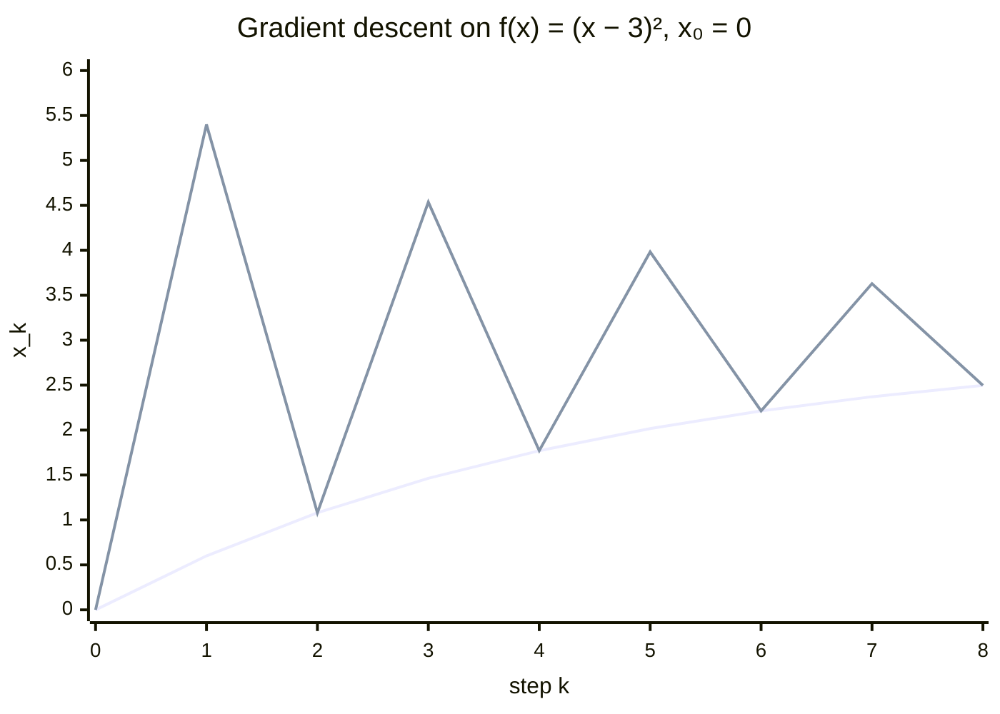

# GATE DA · Day 6 of 20
## Calculus and Optimisation: limits, continuity, derivatives, Taylor series, maxima and minima, gradient descent

*About a 30-minute read. Answers to the practice and recall questions are in the collapsible section at the bottom.*

---

## 1. How GATE asks this

It's the smallest maths section, about **6 marks**, but the marks are easy to get. Typical questions:
- **NAT:** a limit (often 0/0 that needs a Taylor expansion or L'Hôpital), the max or min of a function on an interval, a Taylor coefficient, or the value after k gradient descent steps.
- **MSQ:** continuity and differentiability of piecewise or |x|-type functions, and statements about convexity or critical points.
- **MCQ:** classic optimisation word problems, and gradient descent behaviour for different learning rates.

The syllabus says "single variable". Even so, the gradient and Hessian ideas in 2.10 come up across ML questions.

---

## 2. The ideas from zero

### 2.1 Functions, quickly

A function f takes each input x in its **domain** to exactly one output.

**Domain checks:**
- √(…) needs the inside ≥ 0.
- ln(…) needs the inside > 0.
- a denominator must be ≠ 0.

**Composition:** (f∘g)(x) = f(g(x)).
- An **inverse** exists if f is one-to-one.
- **Even** functions (f(−x) = f(x)) are symmetric about the y-axis. **Odd** functions (f(−x) = −f(x)) are symmetric about the origin.

Shapes to know cold: xⁿ, eˣ, ln x, sin, cos, |x|, 1/x, and the sigmoid σ(x) = 1/(1 + e⁻ˣ) (from ML).

### 2.2 Limits

lim_{x→a} f(x) = L means f(x) gets as close to L as you like when x is close enough to a. **What happens exactly at a doesn't matter.**

- **One-sided limits:** the limit exists ⇔ the left limit = the right limit.
  - Example: lim_{x→0} |x|/x has left limit −1 and right limit +1, so it doesn't exist.

**Standard limits (memorise):**
- lim_{x→0} sin x / x = 1, and lim tan x / x = 1.
- lim_{x→0} (1 − cos x)/x² = ½.
- lim_{x→0} (eˣ − 1)/x = 1, and lim (aˣ − 1)/x = ln a.
- lim_{x→0} ln(1 + x)/x = 1.
- lim_{x→0} (1 + x)^(1/x) = e, and **lim_{x→∞} (1 + a/x)^(bx) = e^(ab).**
- lim_{x→∞} xⁿ/eˣ = 0 (exponentials beat powers), and lim_{x→∞} ln x / xᵖ = 0 for p > 0 (powers beat logs).
- **Rational functions as x → ∞:** compare the highest powers. If the degrees are equal, the limit is the ratio of the leading coefficients. If the numerator's degree is smaller, the limit is 0. If it's bigger, the limit is ±∞.

**Indeterminate forms:** 0/0, ∞/∞, 0·∞, ∞ − ∞, 1^∞, 0⁰, ∞⁰.

**L'Hôpital's rule:** if lim f/g is 0/0 or ∞/∞, then lim f/g = lim f′/g′ (when the right-hand side exists).
- You can repeat it while the form stays indeterminate.
- **Differentiate the top and bottom separately.** It is not the quotient rule.
- For 0·∞, rewrite as a fraction.
- For 1^∞, 0⁰ or ∞⁰: take logs. If y = f^g, then ln y = g·ln f. Find that limit L, and the answer is e^L.

**Taylor shortcut for 0/0** (often faster than L'Hôpital): expand the top and bottom and keep the lowest-order terms. For example:
- sin x − x ≈ −x³/6, so (sin x − x)/x³ → −1/6.

### 2.3 Continuity

f is continuous at a if **lim_{x→a} f(x) = f(a)**. That needs three things: f(a) is defined, the limit exists, and the two are equal.

**Types of discontinuity:**
- **Removable:** the limit exists but ≠ f(a), or f(a) is undefined.
- **Jump:** the left and right limits differ.
- **Infinite:** like 1/x at 0.
- **Oscillating:** like sin(1/x) at 0.

Polynomials, eˣ, sin and cos are continuous everywhere. ln x, √x and rational functions are continuous on their domains. Sums, products and compositions of continuous functions are continuous, and so are quotients where the denominator ≠ 0.

**Piecewise functions:** for continuity at the joining point, match the left limit, the right limit and the function value there.

**Intermediate value theorem:** if f is continuous on [a, b] and f(a), f(b) have opposite signs, then f has a root in (a, b).

### 2.4 Differentiability

f′(a) = lim_{h→0} [f(a+h) − f(a)]/h. It's the slope of the tangent, or the instantaneous rate of change.

- **Differentiable ⇒ continuous.** The converse is **FALSE.**
- **The left derivative must equal the right derivative.**

**Classic counterexamples:**
- **|x| at 0:** continuous, with left slope −1 and right slope +1. **Not differentiable** (a corner).
- **x|x| at 0:** differentiable, with derivative 2|x|, which is 0 at 0.
- **x^(1/3) at 0:** continuous, but the tangent is vertical, so it's not differentiable.
- **x·sin(1/x)** (with f(0) = 0): continuous at 0 but not differentiable.
- **x²·sin(1/x)** (with f(0) = 0): differentiable at 0 with f′(0) = 0, but f′ is not continuous at 0.
- **|x − a|:** a corner at a. **|x² − 1|:** corners at ±1.
- **ReLU max(0, x):** continuous everywhere, not differentiable at 0. ML uses a subgradient there.

**Piecewise differentiability at the join:** match the values (continuity) **and** the left and right derivatives.

### 2.5 Derivative rules

**Core rules:**
- (xⁿ)′ = nxⁿ⁻¹
- (eˣ)′ = eˣ, and (aˣ)′ = aˣ ln a
- (ln x)′ = 1/x
- (sin x)′ = cos x, and (cos x)′ = −sin x
- (tan x)′ = sec²x

**Combining:**
- **Sum:** (f + g)′ = f′ + g′.
- **Product:** (fg)′ = f′g + fg′.
- **Quotient:** (f/g)′ = (f′g − fg′)/g².
- **Chain:** (f(g(x)))′ = f′(g(x))·g′(x).

**ML favourites:**
- Sigmoid: **σ′(x) = σ(x)(1 − σ(x)).** Its maximum is ¼, at x = 0.
- tanh′ = 1 − tanh².
- (e^(−x²))′ = −2x·e^(−x²).
- (ln(1 + eˣ))′ = σ(x). This is the softplus function.

**Higher derivatives:**
- f″ is the rate of change of the slope, i.e. **curvature.**
- f″ > 0 means the curve is concave up (cup-shaped).
- An **inflection point** is where f″ changes sign.

### 2.6 Taylor and Maclaurin series

Near a, a smooth function looks like a polynomial:

**f(x) = f(a) + f′(a)(x−a) + f″(a)(x−a)²/2! + … + f⁽ⁿ⁾(a)(x−a)ⁿ/n! + …**

The **Maclaurin** series is the special case a = 0. **The coefficient of xⁿ is f⁽ⁿ⁾(0)/n!.**

**The five series to know by heart:**
- **eˣ** = 1 + x + x²/2! + x³/3! + …, for all x.
- **sin x** = x − x³/3! + x⁵/5! − …: odd powers only, alternating signs.
- **cos x** = 1 − x²/2! + x⁴/4! − …: even powers only.
- **ln(1 + x)** = x − x²/2 + x³/3 − …, for −1 < x ≤ 1.
- **1/(1 − x)** = 1 + x + x² + x³ + …, for |x| < 1 (geometric series).
  - So 1/(1 + x) = 1 − x + x² − …

**Derived ones:**
- e^(ax): substitute ax for x. The coefficient of xⁿ is aⁿ/n!.
- tan x = x + x³/3 + …
- (1 + x)ⁿ ≈ 1 + nx for small x (binomial approximation).
- e^(−x²) = 1 − x² + x⁴/2 − …

**Uses:**
1. **Approximation:** e^0.1 ≈ 1.10517, using 4 terms.
2. **Limits:** see the Taylor shortcut in 2.2.
3. **Optimisation:** the second-order expansion f(x + h) ≈ f(x) + f′(x)h + ½f″(x)h² gives both Newton's method and the second-derivative test.

**Error:** the size of the first term you dropped is a good estimate of the error. For alternating series, it's a bound.

### 2.7 Mean value theorems (in brief)

- **Rolle's theorem:** if f is continuous on [a, b], differentiable on (a, b), and f(a) = f(b), then f′(c) = 0 for some c in (a, b).
- **Lagrange MVT:** with the same conditions minus f(a) = f(b), **f′(c) = [f(b) − f(a)]/(b − a)** for some c in (a, b). Somewhere the instantaneous slope equals the average slope.
  - Example: x² on [1, 3]. The average slope is (9 − 1)/2 = 4, and 2c = 4 gives c = 2.
- **Consequences:**
  - f′ = 0 on an interval ⇒ f is constant.
  - f′ > 0 ⇒ f is strictly increasing.
- **Check the conditions.** GATE asks about functions like |x| on [−1, 1]: f(−1) = f(1), but there's no c with f′(c) = 0. Rolle doesn't apply, because |x| isn't differentiable at 0.

### 2.8 Maxima, minima and optimisation

**Critical points:** f′(x) = 0 (stationary points) **or** f′ doesn't exist (corners, cusps).

**First derivative test** (at a critical point c):
- f′ changes from + to − ⇒ **local max.**
- − to + ⇒ **local min.**
- No sign change ⇒ neither. For example, x³ at 0 is a flat inflection point.

**Second derivative test** (at a stationary point, f′(c) = 0):
- f″(c) > 0 ⇒ local **min** (cup).
- f″(c) < 0 ⇒ local **max** (cap).
- f″(c) = 0 ⇒ **inconclusive.** x⁴ has a min at 0, −x⁴ has a max, x³ has neither. Fall back to the first derivative test or higher derivatives.
- **Higher-derivative rule:** if the first nonzero derivative at c has **even** order n, it's an extremum (min if f⁽ⁿ⁾(c) > 0). If n is **odd**, it's an inflection point.

**Global (absolute) extremes on a closed interval [a, b]:**
- A continuous f always has them (extreme value theorem).
- **Recipe:** evaluate f at **every critical point inside (a, b) and at both endpoints a and b**, then take the largest and smallest values.
- Forgetting the endpoints is the most common lost mark.

**On open or unbounded intervals:** a global extremum may not exist. Check the behaviour as x → ±∞ or at the edges.

**Convexity:** f is convex if the chord between any two points lies above the graph:

**f(tx + (1−t)y) ≤ t·f(x) + (1−t)·f(y)**

- For twice-differentiable f: **convex ⇔ f″ ≥ 0** everywhere. It's **strictly convex** if f″ > 0.
- **Key fact for ML:** for a convex f, **every local minimum is a global minimum.** A strictly convex f has at most one minimiser.
- **Convex examples:**
  - x², eˣ, |x|, −ln x on x > 0
  - max of convex functions
  - sums of convex functions with non-negative weights
  - **MSE and logistic loss**, which are convex in the weights
- **Concave:** −f is convex. Examples: ln x and √x.
- **Jensen's inequality:** for convex f, f(E[X]) ≤ E[f(X)].

**Word-problem method:**
1. Write the quantity to optimise as a function of **one** variable, using the constraint to eliminate the others.
2. Find the domain.
3. Set f′ = 0.
4. Check the critical points and endpoints.

Classics:
- The rectangle with fixed perimeter and max area is a **square.**
- The open box cut from a square sheet.
- Minimising distance to a curve.

### 2.9 Gradient descent (GATE DA likes this)

**Idea:** to minimise f, step **against** the slope, because downhill is −f′:

**xₖ₊₁ = xₖ − η·f′(xₖ)**

η is the **learning rate**, i.e. the step size.

- f′ > 0 means you're to the right of the minimum, so x moves left. f′ < 0 means x moves right.
- At a minimum f′ = 0, so the updates stop. GD finds **stationary points.** On a non-convex f it can stop at a local minimum or even get stuck at a saddle.

**Learning rate behaviour,** worked out on f(x) = a(x − c)² (f″ = 2a):
- The update is xₖ₊₁ − c = (1 − 2aη)(xₖ − c). The **error shrinks by a factor of |1 − 2aη| each step.**
- **0 < η < 1/(2a):** monotone convergence. Small η is slow.
- **η = 1/(2a):** converges **in one step** (the optimal η for a quadratic).
- **1/(2a) < η < 1/a:** converges, but **zigzags** across the minimum.
- **η = 1/a:** bounces between two points forever.
- **η > 1/a:** **diverges.**
- General rule: converges if **0 < η < 2/L**, where L is the maximum of f″ (the smoothness constant).

Here is f(x) = (x − 3)² from x₀ = 0, showing xₖ at each step. The lower, smooth line is **η = 0.1** creeping steadily up to 3. The zigzag line is **η = 0.9** jumping back and forth across 3. Both converge to the minimum at x = 3.

**Variants:**
- **Stochastic GD:** uses the gradient on one random sample (or a minibatch). Each step is cheaper but noisier.
- **Momentum:** keeps a running average of past gradients.
- **Newton's method:** xₖ₊₁ = xₖ − f′(xₖ)/f″(xₖ). It uses curvature and minimises a quadratic in one step.

### 2.10 Partial derivatives and gradients (preview for the ML days)

For f(x, y), the **partial derivative** ∂f/∂x is the derivative with respect to x, holding y constant.

- **Gradient:** ∇f = (∂f/∂x, ∂f/∂y). It points in the direction of **steepest ascent**, so GD moves along −∇f.
- **Hessian:** H = [[f_xx, f_xy], [f_yx, f_yy]]. It's symmetric for smooth f.
- **Critical point:** ∇f = 0. Classify it using the Hessian's definiteness from Day 5:
  - **PD ⇒ local min.**
  - Negative definite ⇒ local max.
  - **Indefinite ⇒ saddle.**
  - 2×2 shortcut: D = f_xx·f_yy − f_xy². D > 0 and f_xx > 0 ⇒ min. D > 0 and f_xx < 0 ⇒ max. D < 0 ⇒ saddle.
- **Example:** f = x²y + 3y² gives ∇f = (2xy, x² + 6y) and H = [[2y, 2x], [2x, 6]].
- **Vector rules:**
  - ∇(aᵀx) = a
  - ∇(xᵀAx) = (A + Aᵀ)x, which is 2Ax for symmetric A
  - ∇‖Ax − b‖² = 2Aᵀ(Ax − b). Set it to 0 to get the normal equation (Day 14).

---

## 3. Worked examples

**Example 1: three limits, three methods (NAT)**

(a) lim_{x→0} (sin x − x)/x³
- **Taylor:** sin x − x = −x³/6 + x⁵/120 − …, so the ratio → **−1/6 ≈ −0.167.**
- L'Hôpital takes three rounds to reach −cos x/6 at 0 = −1/6. Same answer, slower.

(b) lim_{x→∞} (1 + 2/x)^x
- This is the 1^∞ form. Use the rule lim (1 + a/x)^(bx) = e^(ab) with a = 2, b = 1. Answer: **e² ≈ 7.389.**
- Via logs: ln y = x·ln(1 + 2/x) ≈ x·(2/x) = 2, so y → e².

(c) lim_{x→0} (eˣ − 1 − x)/x²
- eˣ − 1 − x = x²/2 + x³/6 + …, so the limit is **½.**

**Example 2: make a piecewise function differentiable (NAT)**
*f(x) = ax + b for x < 1, and f(x) = x² for x ≥ 1. Find a and b so that f is differentiable at x = 1.*

- **Continuity at 1:** a(1) + b = 1² ⇒ a + b = 1.
- **Equal slopes at 1:** left slope a, right slope 2x at 1 = 2 ⇒ **a = 2.**
- Then **b = −1.** So f is the tangent line 2x − 1 glued onto x².
- With continuity but different slopes, you'd get a corner like |x|.

**Example 3: Taylor approximations (NAT)**

e^0.1:
- 1 + 0.1 + 0.005 + 0.0001667 = **1.1051667.**
- The true value is 1.1051709, so the error ≈ 4×10⁻⁶. That's about the size of the next term, x⁴/24 ≈ 4.2×10⁻⁶.

ln(1.2), with x = 0.2:
- 0.2 − 0.02 + 0.002667 = **0.18267.**
- The true value is 0.18232. ln converges more slowly, so you'd need more terms.

Coefficient of x³ in e^(2x): 2³/3! = 8/6 = **4/3.**

**Example 4: global vs local extremes on a closed interval (NAT/MSQ)**
*f(x) = x³ − 6x² + 9x + 1 on [0, 5].*

- f′ = 3x² − 12x + 9 = 3(x − 1)(x − 3), so the critical points are **x = 1 and x = 3.**
- f″ = 6x − 12.
  - f″(1) = −6 < 0 ⇒ **local max**, f(1) = 5.
  - f″(3) = 6 > 0 ⇒ **local min**, f(3) = 1.
- **Endpoints:** f(0) = 1 and f(5) = 125 − 150 + 45 + 1 = **21.**
- **Global max = 21 at x = 5** (an endpoint, not the local max).
- **Global min = 1**, reached at x = 0 and at x = 3.
- An MSQ might say "the global maximum occurs at x = 1". That's false.

**Example 5: optimisation word problem, open box (NAT)**
*Cut equal squares of side x from the corners of a 12 × 12 sheet and fold it into an open box. Which x gives the maximum volume?*

- V(x) = x(12 − 2x)², with domain 0 < x < 6.
- V′(x) = (12 − 2x)² − 4x(12 − 2x) = (12 − 2x)(12 − 6x) = 0 ⇒ x = 6 (rejected, since V = 0 there) or **x = 2.**
- **V(2) = 2·8² = 128.**
- V′ changes from + to − at 2, so it's a max. ✓

**Example 6: gradient descent by hand (NAT, the chart in 2.9)**
*f(x) = (x − 3)², x₀ = 0, η = 0.1. Find x₁, x₂ and x₃.*

- f′(x) = 2(x − 3).
- x₁ = 0 − 0.1·2(0 − 3) = **0.6.**
- x₂ = 0.6 − 0.1·2(−2.4) = **1.08.**
- x₃ = 1.08 − 0.1·2(−1.92) = **1.464.**
- **Pattern:** the error from 3 shrinks by a factor of (1 − 2η) = 0.8 each step, so xₖ = 3(1 − 0.8ᵏ).
- **Other step sizes** (here a = 1, so 1/(2a) = 0.5 and 1/a = 1):
  - **η = 0.5** jumps straight to 3 in one step.
  - **η = 0.9:** the factor is −0.8, so it zigzags: 0 → 5.4 → 1.08 → 4.536 → … and still converges.
  - **η = 1** bounces 0 ↔ 6 forever.
  - **η = 1.1** diverges.

**Example 7: MVT and Rolle checks (MCQ)**
- For f(x) = x² on [1, 3], the MVT point is c = 2. The average slope 4 equals f′(2) = 4.
- For f(x) = |x| on [−1, 1], f(−1) = f(1), but Rolle's theorem **doesn't apply**. f isn't differentiable at 0, and no point has slope 0.

---

## 4. Common traps

1. **Endpoints in global optimisation.** Always evaluate f(a) and f(b). The global max is often at an endpoint (Example 4).
2. **f″(c) = 0 isn't "inflection".** x⁴ has f″(0) = 0, but 0 is a minimum. Use the first derivative test.
3. **Continuous ≠ differentiable.** |x|, x^(1/3) and ReLU are continuous but have corners or vertical tangents.
4. **L'Hôpital only for 0/0 or ∞/∞.** Differentiate the top and bottom separately, and rewrite the other forms first.
5. **The 1^∞ form isn't 1.** lim (1 + 1/x)^x = e, not 1.
6. **The Taylor coefficient of xⁿ is f⁽ⁿ⁾(0)/n!.** Don't forget the factorial.
7. **The sign in gradient descent is minus.** x − ηf′(x) minimises. A plus sign would maximise (gradient ascent).
8. **A larger η is not always faster.** Past 2/L it diverges. Between 1/L and 2/L it oscillates.
9. **Critical points include points where f′ doesn't exist** (corners). The minimum of |x − 2| is at a corner, not where f′ = 0.
10. **The quadratic-form Hessian test uses definiteness,** not just the sign of f_xx. D < 0 means a saddle whatever f_xx is.
11. **Domain restrictions.** A critical point outside the domain (like x = 6 for the box) doesn't count.

---

## 5. Cheat card

**Limits**
- sin x/x → 1. (1 − cos x)/x² → ½. (eˣ − 1)/x → 1. ln(1+x)/x → 1.
- (1 + a/x)^(bx) → e^(ab).
- L'Hôpital for 0/0 and ∞/∞. Logs for 1^∞, 0⁰, ∞⁰.
- Growth order: ln x ≪ xᵖ ≪ eˣ.

**Continuity and differentiability**
- Continuous: lim = f(a). Differentiable: left slope = right slope. Differentiable ⇒ continuous, not the other way round.
- |x|: corner. x|x|: differentiable. x^(1/3): vertical tangent. x sin(1/x): continuous but not differentiable. x² sin(1/x): differentiable.

**Derivatives**
- Product, quotient and chain rules. σ′ = σ(1 − σ).

**Taylor**
- f(x) ≈ Σ f⁽ⁿ⁾(a)(x−a)ⁿ/n!.
- eˣ = Σ xⁿ/n!. sin = x − x³/6 + …. cos = 1 − x²/2 + …. ln(1+x) = x − x²/2 + x³/3 − …. 1/(1−x) = Σxⁿ.

**Mean value theorems**
- MVT: f′(c) = (f(b) − f(a))/(b − a). Rolle: f(a) = f(b) ⇒ f′(c) = 0. Both need continuity and differentiability.

**Extremes**
- Critical points: f′ = 0 or f′ undefined.
- f″ > 0 → min, f″ < 0 → max, f″ = 0 → use another test.
- Global on [a, b]: check the critical points and the endpoints.

**Convexity**
- Convex ⇔ f″ ≥ 0. Local min = global min. Jensen: f(E[X]) ≤ E[f(X)].

**Gradient descent**
- xₖ₊₁ = xₖ − ηf′(xₖ).
- On a(x−c)²: the error is multiplied by (1 − 2aη) each step. η = 1/(2a) is one step. η < 1/a converges. η > 1/a diverges.
- In general, converges if 0 < η < 2/L.
- Newton: x − f′/f″.

**Multivariable**
- ∇f points uphill. Hessian PD → min, ND → max, indefinite → saddle. D = f_xx·f_yy − f_xy².
- ∇(xᵀAx) = 2Ax (symmetric A). ∇‖Ax − b‖² = 2Aᵀ(Ax − b).

---

## 6. Practice

**Q1 (NAT, 1 decimal).** Find lim_{x→0} (1 − cos x)/x².

**Q2 (NAT, 2 decimals).** Find lim_{x→0} (tan x − x)/x³.

**Q3 (MSQ).** Let f(x) = |x − 2|. Which statements are TRUE?
(a) f is continuous at x = 2
(b) f is differentiable at x = 2
(c) f has a global minimum at x = 2
(d) f is convex on ℝ

**Q4 (NAT, 3 decimals).** Find the maximum value of f(x) = x·e^(−x) for x ≥ 0.

**Q5 (NAT).** Gradient descent minimises f(x) = x², starting at x₀ = 4 with learning rate η = 0.25. What is x₂?

**Q6 (MCQ).** What is the coefficient of x³ in the Maclaurin series of e^(2x)?
(a) 2/3  (b) 4/3  (c) 8  (d) 8/3

### Recall: Day 5

**R1.** What are the eigenvalues of [[3, 1], [0, 5]]?

**R2.** What are the singular values of an orthogonal matrix?

**R3.** Is the quadratic form x² − y² positive definite, negative definite or indefinite?

---

**Next, Day 7:** Python for GATE. Predicting what code prints, covering mutability and aliasing, slicing, scope and closures, recursion, generators, and the Big-O basics.

---

<b>Answers</b> (click to open)

**Q1: 0.5.** cos x = 1 − x²/2 + …, so 1 − cos x ≈ x²/2, which gives ½.

**Q2: 0.33.** tan x = x + x³/3 + …, so (tan x − x)/x³ → 1/3.

**Q3: (a), (c), (d).**
- (b) is false: there's a corner at 2, with left slope −1 and right slope +1.
- The minimum value 0 at x = 2 is global.
- |x − 2| is convex, since the chord always lies above the graph.

**Q4: 0.368.**
- f′ = e^(−x)(1 − x) = 0 gives x = 1.
- f′ changes from + to −, so it's a max. f(1) = 1/e ≈ 0.368.

**Q5: 1.**
- f′ = 2x, so xₖ₊₁ = x − 0.25·2x = 0.5x.
- x₁ = 2 and x₂ = 1.

**Q6: (b).** (2x)³/3! = 8x³/6, so the coefficient is 4/3.

**Recall**
- **R1:** 3 and 5. It's triangular, so read off the diagonal.
- **R2:** all equal to 1.
- **R3:** indefinite. The eigenvalues are +1 and −1.

