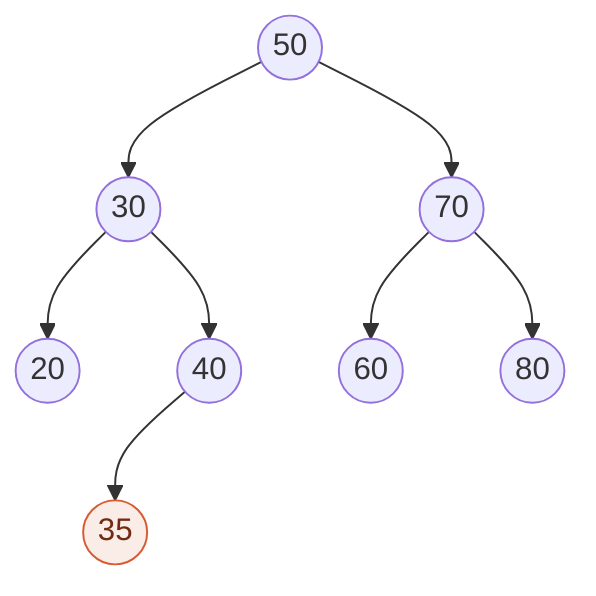

# GATE DA · Day 8 of 20
## Data structures: stacks, queues, linked lists, trees, BSTs, heaps, hash tables

*About a 30-minute read. Answers to the practice and recall questions are in the collapsible section at the bottom. All the traces below were checked by running them in Python.*

---

## 1. How GATE asks this

The syllabus names stacks, queues, linked lists, trees and hash tables. In past DA and CS papers, these come up as:
- **NAT:** the slot a key lands in after probing, a postfix value, the height or number of nodes or leaves, or the array after a heap operation.
- **MCQ:** a traversal order, a tree rebuilt from traversals, which stack output is impossible, or a linked-list code snippet.
- **MSQ:** true/false statements about complexity or properties (BST inorder is sorted, build-heap is O(n)…).

Almost every question is a **trace**. Do them slowly on paper and keep the array or tree drawn as you go.

---

## 2. The concepts from zero

### 2.1 Stack (LIFO)

The last element in is the first out. Operations: push, pop, peek (top), isEmpty, all **O(1)**.
- It can be built on an array (`list.append` / `list.pop` in Python) or on a linked list (push and pop at the head).
- **Uses:** function calls and recursion (the call stack), undo, bracket matching, expression conversion and evaluation, DFS, backtracking.

**Infix → postfix (shunting-yard)**

Scan left to right:
- **Operand** → send it straight to the output.
- **`(`** → push it.
- **`)`** → pop to the output until you reach the matching `(`. Discard both brackets.
- **Operator op:** while the top of the stack is an operator with **higher precedence**, or **equal precedence and op is left-associative**, pop it to the output. Then push op.
- At the end, pop everything left on the stack.

Precedence and associativity:
- `^` is highest and **right-associative**: a^b^c = a^(b^c).
- `* /` come next, left-associative.
- `+ −` are lowest, left-associative.

Prefix notation puts each operator before its operands.

**Postfix evaluation**
- Operand → push it.
- Operator → pop **b** (the top), then pop **a**, push (a op b).
- **The order matters for − / ^:** the second element popped is the *left* operand.

**Bracket matching:** push each opening bracket. On a closing bracket, the top must be its match. At the end, the stack must be empty.

**Stack permutations:** push 1, 2, …, n in order, popping whenever you like. **The number of possible output orders is the Catalan number** Cₙ = C(2n, n)/(n+1): 1, 2, 5, 14, 42 for n = 1…5.
- An output is **impossible** if it contains a pattern …c…a…b… with a < b < c. Example: for 1 2 3, the output **3 1 2** is impossible. Once 3 is popped, 2 sits on top of 1, so 2 must come out before 1.

### 2.2 Queue (FIFO), circular queue, deque

The first element in is the first out. enqueue at the rear, dequeue at the front, both **O(1)**.
- A plain array queue wastes the slots at the front. The fix is a **circular queue**: indices wrap around with `(i + 1) % size`.
  - Common convention: **empty when front == rear; full when (rear + 1) % size == front.** One slot is left empty so the two states look different, so the capacity is size − 1. Read the question to see which convention it uses.
- **Deque:** insert and delete at both ends, all O(1). Python's `collections.deque`.
  - Input-restricted: insertion at one end only. Output-restricted: deletion at one end only.
- **Priority queue:** dequeue removes the highest (or lowest) priority item. It's implemented with a **heap** (2.6).

**Queue from two stacks:**
- Enqueue → push onto S1.
- Dequeue → if S2 is empty, pop everything from S1 onto S2 (which reverses the order). Then pop from S2.
- Each element moves at most twice, so it's **amortised O(1)**, though a single dequeue can take O(n) in the worst case.

**Stack from two queues** is also possible: either push or pop costs O(n).

**Uses:** BFS, scheduling, buffers.

### 2.3 Linked lists

Nodes hold data plus a pointer to the next node. There's no random access, so reaching index i takes **O(i)**.
- **Singly linked:**
  - Insert or delete at the head: O(1).
  - Insert at the tail: O(1) only if you keep a tail pointer, otherwise O(n).
  - Delete a given node: O(n), because you need its predecessor (or copy the next node's data into it, which doesn't work for the last node).
- **Doubly linked:** prev and next pointers. Deleting a node you already have a pointer to is **O(1)**, at the cost of extra memory.
- **Circular:** the last node points back to the head. Useful for round-robin scheduling. To detect the end, check whether you're back at the head.

**Classic algorithms:**
- **Reverse, iteratively in O(n) time and O(1) space:**
  - `prev=None; cur=head`
  - `while cur: nxt=cur.next; cur.next=prev; prev=cur; cur=nxt`
  - `head = prev`
- **Middle node:** a slow pointer moves 1 step and a fast pointer 2 steps. When fast reaches the end, slow is at the middle.
- **Cycle detection (Floyd's tortoise and hare):** slow moves +1, fast moves +2. If they ever meet, there's a cycle. To find where the cycle starts, reset one pointer to the head and move both at +1. They meet at the cycle's start. O(n) time, O(1) space.
- **Merging two sorted lists:** O(m + n).
- **Arrays vs linked lists:** arrays give O(1) access and cache locality, but inserting in the middle is O(n). Linked lists insert in O(1) once you've found the position, but finding it is O(n).

### 2.4 Trees and binary trees

**Terminology:**
- root, parent, child, sibling, leaf (no children), internal node
- **depth** of a node = the number of edges from the root
- **height** of the tree = the maximum depth. GATE usually says height = number of edges, so a single node has height 0. **Check each question's convention.**
- level, subtree, degree (number of children)

**Binary tree properties** (≤ 2 children per node):
- Max nodes at level i = 2ⁱ.
- **Max nodes in a tree of height h = 2^(h+1) − 1.**
- **Min height with n nodes = ⌈log₂(n + 1)⌉ − 1.** Max height = n − 1 (a chain).
- **In any binary tree, leaves = (nodes with 2 children) + 1.** That is, n₀ = n₂ + 1.
- **Full (strict) binary tree** (every node has 0 or 2 children): with i internal nodes there are i + 1 leaves and 2i + 1 nodes in total. More generally, a full k-ary tree with i internal nodes has (k−1)i + 1 leaves.
- **Complete binary tree:** every level is full except possibly the last, which is filled **left to right**. Heaps are complete trees, which is why they fit neatly in an array.
- **Perfect:** every level is completely full, with 2^(h+1) − 1 nodes.
- **Number of structurally different binary trees with n nodes = Catalan Cₙ.** With 3 nodes there are 5 shapes. The **number of BSTs on n distinct keys** is also Cₙ.

**Array storage** (0-indexed): node i has its children at 2i + 1 and 2i + 2, and its parent at ⌊(i − 1)/2⌋. With 1-indexing it's 2i, 2i + 1 and ⌊i/2⌋.

**Traversals** (all O(n)):
- **Preorder:** Root, Left, Right. Copies the tree, gives prefix notation.
- **Inorder:** Left, Root, Right. Gives **sorted order for a BST**, and infix for expression trees.
- **Postorder:** Left, Right, Root. Used for deleting or freeing a tree, and gives postfix.
- **Level order:** BFS with a queue.
- In preorder the **first** item is the root. In postorder the **last** item is the root.

**Rebuilding a tree:**
- **Inorder plus pre- or post-order uniquely identifies a binary tree** (with distinct keys).
  - Method: find the root from pre/post, find it in the inorder, then split the inorder into the left and right subtrees and recurse.
- **Preorder plus postorder alone is NOT enough** in general (a single child could be on either side). The exception is a **full** binary tree.
- **For a BST, preorder alone is enough,** because its inorder is just the sorted keys.

### 2.5 Binary search trees (BST)

**Invariant:** for every node, all keys in the left subtree < the node < all keys in the right subtree.

- **Search, insert and delete all cost O(h).**
  - Balanced tree: h ≈ log n.
  - **Worst case: h = n − 1**, giving **O(n)**. This happens when keys are inserted in sorted (or reverse-sorted) order, producing a chain.
- **Insert:** walk down as if searching, then attach the new key as a leaf. The **insertion order decides the shape.**
- **Delete:**
  - A leaf: just remove it.
  - One child: link the child directly to the parent.
  - **Two children:** replace the node's key with its **inorder successor** (the minimum of its right subtree) or its inorder predecessor (the maximum of its left subtree), then delete that node. It has at most one child, so it's an easy case.
- Min = the leftmost node. Max = the rightmost.
- **Inorder traversal = the keys in sorted order.** Sorting n items by building a BST takes O(n²) in the worst case.

**AVL trees (the idea):**
- A BST where, for every node, |height(left) − height(right)| ≤ 1. That difference is the balance factor.
- After an insert or delete, rebalance with **rotations**: LL → right rotation, RR → left rotation, LR or RL → a double rotation.
- This keeps h = O(log n), so every operation is guaranteed **O(log n)**.
- **Minimum nodes in an AVL tree of height h:** N(h) = N(h−1) + N(h−2) + 1, with N(0) = 1 and N(1) = 2. That gives 1, 2, 4, 7, 12, 20, … (Fibonacci-like). GATE asks this.
- Red-black trees and B-trees are other balanced trees. B+ trees come on Day 12.

### 2.6 Heaps (binary heaps)

A **complete binary tree** stored in an array, with the **heap property**:
- **Max-heap:** every parent ≥ its children, so the **max is at the root.**
- **Min-heap:** every parent ≤ its children.

The heap is **not sorted.** It only guarantees order along each path from the root to a leaf.

**Operations:**
- **Insert:** append at the end, then **sift up** (swap with the parent while it's bigger than the parent). O(log n).
- **Delete-max (extract):** move the last element to the root, then **sift down** (swap with the **larger** child until the heap property holds). O(log n).
- **Find max:** O(1).
- **Build-heap (bottom-up heapify):** call sift-down on every internal node, from index ⌊n/2⌋ − 1 down to 0. The cost is **O(n), not O(n log n)**, because most nodes are near the bottom and sift down only a little. Inserting the n items one by one instead costs O(n log n).
- **Heapsort:** build-heap, then delete-max n times. O(n log n), in place, not stable.

**Positions:**
- In a max-heap, the **minimum is in one of the leaves**: indices ⌊n/2⌋ to n − 1, roughly the last half of the array.
- The k-th largest element lies within the top k levels.
- Searching for an arbitrary key is O(n).

### 2.7 Hash tables

Store keys in an array of m slots at the position h(k). This gives **O(1) average** search, insert and delete.

- **Hash functions:**
  - **Division:** h(k) = k mod m. Choose m to be a **prime** not close to a power of 2.
  - Multiplication method.
  - **Universal hashing** picks h at random from a family, which guards against an adversary choosing bad keys.
- **Load factor α = n/m**, the number of keys per slot.

**Collision resolution:**

1. **Separate chaining:** each slot holds a linked list.
   - Expected chain length is α, and α can exceed 1.
   - **Unsuccessful search: 1 + α** expected probes. **Successful search: 1 + α/2.**
   - **Worst case O(n),** if everything hashes to one slot.
   - Deleting is easy.

2. **Open addressing:** all keys live in the table itself, so α ≤ 1. On a collision, probe a sequence of slots hᵢ(k), for i = 0, 1, 2, …
   - **Linear probing:** hᵢ = (h(k) + i) mod m.
     - Simple and cache-friendly.
     - Suffers from **primary clustering**: long runs of filled slots grow longer, because any key landing in a run extends it.
   - **Quadratic probing:** hᵢ = (h(k) + c₁i + c₂i²) mod m. Often just + i².
     - Avoids primary clustering but has **secondary clustering**: keys with the same h(k) follow the same probe path.
     - It may fail to find an empty slot even when one exists, unless m is chosen carefully.
   - **Double hashing:** hᵢ = (h₁(k) + i·h₂(k)) mod m, with h₂(k) ≠ 0 and coprime to m.
     - The probe sequence depends on the key, which is the closest to ideal "uniform hashing".
   - **Expected probes** under uniform hashing: unsuccessful ≈ **1/(1 − α)**. Successful ≈ (1/α)·ln(1/(1 − α)).
     - At α = 0.5, an unsuccessful search takes about 2 probes. At 0.9, about 10.
   - **Deleting** needs a "deleted" tombstone marker. Simply emptying the slot would break searches for later keys in the same probe chain.

**Python's dict and set** use open addressing and resize to keep α low.

---

## 3. Worked examples

**Example 1: infix → postfix, then evaluate a postfix expression (MCQ/NAT)**

*Convert A + B * C − D / E ^ F ^ G.*

- Precedence is ^ > * / > + −, and ^ is right-associative.
- A → output. + → push.
- B → output. * outranks +, so push it.
- C → output.
- Reach −. Pop * and then + (both ≥ −, left-associative), then push −.
- D → output. / → push (it outranks −).
- E → output. ^ → push.
- F → output. The next ^ has the same precedence but is right-associative, so **push** without popping.
- G → output.
- End: pop ^, ^, /, −.
- **Postfix: A B C * + D E F G ^ ^ / −**

Also: (A + B) * (C − D) / E → **A B + C D − * E /**.

*Evaluate 6 2 3 + − 3 8 2 / + * 2 ^ 3 +.*

| Token | Stack after |
|---|---|
| 6 2 3 | [6, 2, 3] |
| + | [6, 5] |
| − | 6 − 5 = 1 → [1] |
| 3 8 2 | [1, 3, 8, 2] |
| / | 8/2 = 4 → [1, 3, 4] |
| + | [1, 7] |
| * | [7] |
| 2 ^ | 7² = 49 |
| 3 + | **52** |

**Example 2: BST insert order, traversals and deletion**

*Insert 50, 30, 70, 20, 40, 60, 80, 35.* Each key walks left or right from the root until it finds a free spot:



35 is **40's left child** (highlighted: it's the inorder successor of 30).

- **Preorder:** 50 30 20 40 35 70 60 80
- **Inorder:** 20 30 35 40 50 60 70 80 (sorted ✓)
- **Postorder:** 20 35 40 30 60 80 70 50
- **Height (edges):** 3, along the path 50–30–40–35.
- **Delete 30,** which has two children:
  - Its inorder successor is the minimum of its right subtree: go to 40, then left to **35**.
  - Copy 35 into 30's place and delete the old 35 (a leaf).
  - Now 50's left child is 35, with children 20 and 40.
- **Worst case:** inserting 10, 20, 30, 40, 50 in order makes a right-leaning chain of height **4 = n − 1**, so search costs O(n).

**Example 3: rebuild a tree from two traversals (MCQ)**

*Preorder A B D E C F, inorder D B E A F C. Find the postorder.*

- The preorder starts with **A**, so A is the root. In the inorder, A splits the keys into left {D, B, E} and right {F, C}.
- **Left subtree:** its preorder is B D E, so its root is **B**. Its inorder D B E puts D on the left and E on the right.
- **Right subtree:** its preorder is C F, so its root is **C**. Its inorder F C puts F as **C's left child**.

```
        A
      /   \
     B     C
    / \   /
   D   E F
```

- **Postorder: D E B F C A.**

**Example 4: the same keys under three probing schemes (NAT)**

*m = 10, h(k) = k mod 10. Insert 43, 23, 13, 27, 37, 3 in that order.*

**Linear probing (+1 each step):**
- 43 → 3.
- 23 → 3 taken → **4**.
- 13 → 3, 4 taken → **5**.
- 27 → 7.
- 37 → 7 taken → **8**.
- 3 → 3, 4, 5 taken → **6**.
- **Table:** 3:43, 4:23, 5:13, 6:3, 7:27, 8:37.
- That's one cluster of 6 filled slots in a row, which is primary clustering at work.

**Quadratic probing (+i²: +1, +4, +9, …):**
- 43 → 3.
- 23 → 3, then 4.
- 13 → 3, 4, then 3 + 4 = **7**.
- 27 → 7 taken, 8.
- 37 → 7, 8, then 7 + 4 = 11 mod 10 = **1**.
- 3 → 3, 4, 7, then 3 + 9 = 12 mod 10 = **2**.
- **Table:** 1:37, 2:3, 3:43, 4:23, 7:13, 8:27.

**Double hashing, h₂(k) = 7 − (k mod 7):**
- 43 → 3.
- 23: h₂ = 7 − 2 = 5, so 3 → **8**.
- 13: h₂ = 7 − 6 = 1, so 3 → **4**.
- 27 → 7.
- 37: h₂ = 7 − 2 = 5, so 7 → 12 mod 10 = **2**.
- 3: h₂ = 7 − 3 = 4, so 3 → 7 (taken) → 11 mod 10 = **1**.
- **Table:** 1:3, 2:37, 3:43, 4:13, 7:27, 8:23.

**Example 5: build a max-heap, then delete-max and insert (NAT)**

*Array [3, 9, 2, 1, 4, 5], with n = 6. Bottom-up build: sift down from index 2 down to 0.*

- **i = 2:** value 2, child 5 → swap → [3, 9, 5, 1, 4, 2].
- **i = 1:** value 9, children 1 and 4 → already fine.
- **i = 0:** value 3, children 9 and 5 → swap with 9 → [9, 3, 5, 1, 4, 2]. Keep sifting 3 down: its children are 1 and 4, so swap with 4.
- **Heap: [9, 4, 5, 1, 3, 2].**

```
        9
      /   \
     4     5
    / \   /
   1   3 2
```

- **Delete-max:** move the last element (2) to the root → [2, 4, 5, 1, 3]. Sift down by swapping with the larger child, 5.
  - Result: **[5, 4, 2, 1, 3].**
- **Insert 10 into [9, 4, 5, 1, 3, 2]:** append it at index 6. Its parent (index 2) is 5, so swap. Then its parent is 9 (index 0), so swap again.
  - Result: **[10, 4, 9, 1, 3, 2, 5].**

**Example 6: counting with tree formulas (NAT)**

- A binary tree has 20 nodes with two children. How many leaves? n₀ = n₂ + 1 = **21.**
- A full binary tree has 15 internal nodes. How many nodes in total? 2·15 + 1 = **31.**
- Max nodes in a binary tree of height 4: 2⁵ − 1 = **31.**
- Min height of a binary tree with 100 nodes: ⌈log₂ 101⌉ − 1 = 7 − 1 = **6.**
- Number of BSTs on keys {1, 2, 3, 4}: C₄ = **14.**
- Number of stack-permutable output orders for 1…4: also **14.**
- Min nodes in an AVL tree of height 4: N = 1, 2, 4, 7, **12.**

---

## 4. Common traps

1. **Height conventions.** Edges vs nodes (a single node has height 0 vs 1). Check the question, because many formulas shift by 1.
2. **Postfix operand order.** For a − b, the first pop is b and the second is a. Swapping them changes the answer for − / ^.
3. **^ is right-associative.** Don't pop an equal-precedence ^.
4. **Preorder + postorder doesn't uniquely fix a tree** (unless it's full). You need the inorder.
5. **BST delete with two children** uses the **minimum of the right subtree** (successor). It's not the right child itself, unless the right child has no left child.
6. **A heap is not sorted.** The array [9, 4, 5, 1, 3, 2] is a valid heap. And the min of a max-heap is in a leaf, not necessarily the last element.
7. **Build-heap is O(n).** Inserting n items one by one is O(n log n). Both produce valid heaps, but possibly different arrays.
8. **Sift down swaps with the LARGER child** in a max-heap. Swapping with the smaller one breaks the property.
9. **Linear probing wraps around:** (h + i) mod m. Don't stop at the end of the table.
10. **Chaining allows α > 1. Open addressing needs α ≤ 1,** and its cost explodes as α → 1.
11. **Deleting in open addressing** needs a tombstone.
12. **Circular queue full/empty conventions** differ between textbooks. Read the question's definition.
13. **Linked list delete is O(1) only if you have the predecessor,** or it's doubly linked. Finding the node is still O(n).

---

## 5. Cheat card: complexity table

| Structure | Access / search | Insert | Delete | Notes |
|---|---|---|---|---|
| Array (unsorted) | O(1) index, O(n) search | O(1) end, O(n) middle | O(n) | |
| Sorted array | O(log n) binary search | O(n) | O(n) | |
| Stack / queue / deque | top/front O(1) | O(1) | O(1) | queue from 2 stacks: amortised O(1) |
| Singly linked list | O(n) | O(1) at head | O(1) at head, O(n) otherwise | |
| Doubly linked list | O(n) | O(1) given the node | O(1) given the node | |
| BST | O(h): log n average, **n worst** | O(h) | O(h) | inorder is sorted |
| AVL tree | O(log n) | O(log n) | O(log n) | |
| Binary heap | max O(1), search O(n) | O(log n) | delete-max O(log n) | build O(n), heapsort O(n log n) |
| Hash table | O(1) average, O(n) worst | O(1) average | O(1) average | chaining: 1 + α; open addressing: 1/(1−α) |

**Formulas**
- n₀ = n₂ + 1. A full binary tree has i + 1 leaves and 2i + 1 nodes.
- Max nodes = 2^(h+1) − 1. Min height = ⌈log₂(n+1)⌉ − 1.
- Heap array (0-indexed): children 2i + 1 and 2i + 2, parent ⌊(i−1)/2⌋. Leaves are at ⌊n/2⌋ … n − 1.
- Catalan Cₙ = C(2n, n)/(n+1): 1, 2, 5, 14, 42. It counts binary tree shapes, BSTs and stack permutations.
- AVL minimum nodes: N(h) = N(h−1) + N(h−2) + 1 → 1, 2, 4, 7, 12, 20.
- Probing:
  - Linear: (h + i) mod m.
  - Quadratic: (h + i²) mod m.
  - Double: (h₁ + i·h₂) mod m.

---

## 6. Practice

**Q1 (NAT).** A full binary tree (every node has 0 or 2 children) has 15 internal nodes. How many leaves does it have?

**Q2 (MCQ).** What is the value of the postfix expression 5 3 2 * + 4 −?
(a) 12  (b) 7  (c) 3  (d) 15

**Q3 (NAT).** A hash table has 7 slots (0–6), h(k) = k mod 7, and uses linear probing. The keys 10, 17, 24 and 3 are inserted in that order. In which slot does key 3 end up?

**Q4 (MSQ).** Which statements are TRUE?
(a) An inorder traversal of a BST visits the keys in sorted order
(b) Building a binary heap from n unsorted elements, bottom-up, takes O(n) time
(c) Searching a BST with n nodes takes O(log n) time in the worst case
(d) In a min-heap with distinct keys, the maximum element is in a leaf

**Q5 (MCQ).** The max-heap array [50, 30, 40, 10, 20, 35] has one delete-max applied. What does the array look like afterwards?
(a) [40, 30, 35, 10, 20]
(b) [35, 30, 40, 10, 20]
(c) [40, 35, 30, 10, 20]
(d) [40, 30, 20, 10, 35]

**Q6 (MCQ).** A binary tree has inorder 4 2 5 1 6 3 and postorder 4 5 2 6 3 1. What is its preorder?
(a) 1 2 4 5 3 6
(b) 1 2 3 4 5 6
(c) 1 4 2 5 3 6
(d) 1 2 4 5 6 3

### Recall: Day 7

**R1.** What does `print(-7 % 3)` print?

**R2.** What does `[x for x in range(5) if x % 2]` evaluate to?

**R3.** What is `x` after `x = [3, 1, 2]; x = x.sort()`?

---

**Next, Day 9:** searching and sorting. Binary search, selection, bubble and insertion sort traced pass by pass, merge sort and quicksort, and solving recurrences with the Master theorem.

---

<details>
<summary><b>Answers</b> (click to open)</summary>

**Q1: 16.** A full binary tree with i internal nodes has i + 1 leaves.

**Q2: (b).** Push 5, 3, 2. Then * gives 6, so the stack is [5, 6]. Then + gives 11. Then 11 − 4 = 7.

**Q3: 6.**
- 10 lands in slot 3.
- 17 hashes to 3, which is taken, so it goes to 4.
- 24 hashes to 3, then tries 4, then lands in 5.
- 3 hashes to 3, then tries 4 and 5, then lands in 6.

**Q4: (a), (b), (d).**
- (c) is false. A skewed BST has height n − 1, so the worst case is O(n).
- (d) is true. In a min-heap, any non-leaf has a larger child, so the maximum can't be an internal node.

**Q5: (a).**
- Move 35 to the root: [35, 30, 40, 10, 20].
- Its larger child is 40, so swap them: [40, 30, 35, 10, 20].

**Q6: (a).**
- The postorder ends with 1, so 1 is the root.
- In the inorder, 1 splits the left part (4 2 5) from the right part (6 3).
- Left subtree: root 2, with children 4 and 5.
- Right subtree: the postorder segment 6 3 makes 3 the root, and 6 is its left child.
- Preorder: 1 2 4 5 3 6.

**Recall**
- **R1:** 2. The `%` result takes the sign of the divisor.
- **R2:** [1, 3].
- **R3:** None. `.sort()` sorts in place and returns None.

</details>
