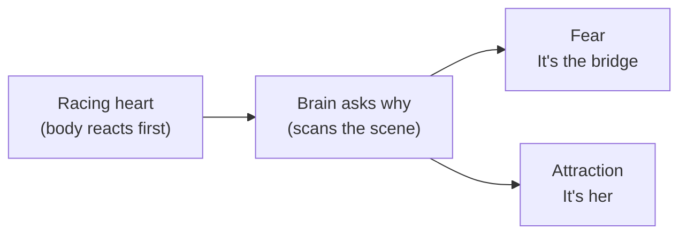

# Psychology · Day 5 of 7
## Fear or love? Your body can't tell: misattribution of arousal

*About a 5-minute read. Answers to the recall questions are in the collapsible section at the bottom.*

---

**North Vancouver, Canada, 1974.** The Capilano Suspension Bridge is about 140 metres of narrow wooden planks, hung by cables about 70 metres above a rocky river. It sways. It wobbles in the wind. The handrails are low. Walking across it, your heart pounds whether you like it or not.

A young man reaches the middle, legs a little shaky. A friendly, attractive young woman stops him: *"Hi, I'm doing a psychology project. Would you fill in a quick questionnaire?"* He does. At the end she tears off a corner of the paper, writes her name and phone number, and says: *"If you want to know more about the study, give me a call."*

Upstream, on a solid, low cedar bridge barely 3 metres above a gentle stream, the same woman does the exact same thing with other men.

The researchers, Donald Dutton and Arthur Aron, only wanted to know one thing: **who calls her?**

## The visual

| Who called her afterwards | |
|---|---|
| Shaky bridge | **9 of 18** called |
| Solid bridge | **2 of 16** called |

**Half** of the men on the scary bridge called her, compared with only about 1 in 8 on the safe one. Their questionnaire stories had more romantic content too. And when a *male* interviewer did the same thing, almost nobody called, on either bridge.

## What this means

Your body reacts **first**: pounding heart, sweaty palms, fast breathing. Then your brain looks around and **labels** the feeling based on whatever seems to explain it. And the body signals for fear, excitement and attraction are almost identical.

So on a terrifying bridge, standing next to an attractive stranger, some of that pounding heart got credited to *her*. Psychologists call this **misattribution of arousal**. It's why scary movies and theme parks make surprisingly good dates, and why a near-miss in traffic can turn into rage at the other driver.

**Two practical lessons:**

1. **Naming a feeling calms it.** Brain-scan studies show that putting a feeling into words ("I'm anxious," "I'm angry") reduces its intensity. Psychologists call this **affect labelling**. It turns a vague storm into a specific thing you can handle.
2. **Scams use this on purpose.** "Your account will be blocked in 30 minutes!" "Your son has been arrested, send money now!" Panic floods your body, your brain reads it as *urgency*, and careful thinking (System 2, from Day 3) switches off. The defence: notice the pounding heart, name it ("this is panic"), and refuse to decide until it fades.

**Did it hold up?** Partly. The bridge study is famous but small (fewer than 40 men), and attempts to repeat the exact result have been mixed. The bigger idea, that we read our body's signals and can mislabel them, is well supported by many other studies.

## Try it today

- **On yourself:** the next time you feel a strong emotion today (irritated, anxious, excited), stop and say it out loud or write it: "I'm feeling ____." Rate its strength from 1 to 10 before naming it and again one minute after. Did the number drop?
- **With others:** ask 3 friends (who know it's a little experiment) to do 30 seconds of jumping jacks, then immediately rate a funny meme from 1 to 10. Ask 3 other friends to rate the same meme while calm. Do the out-of-breath friends rate it higher, or lower? Tell them the idea afterwards and discuss: did any of them feel the meme was "more intense"?

## Quick recall: Day 4

1. In Asch's line test, about how often did people go along with the obviously wrong group?
2. What were the two reasons we conform?
3. What single change dropped conformity to about 5%?

Answers

1. On about a third of the rounds (and 3 out of 4 people gave in at least once).
2. To be right (maybe they know something), and to be liked (not wanting to stand out).
3. Just one other person giving the correct answer: a single ally.

---

**Next:** you pick a photo, the researcher secretly swaps it, and you happily explain why you chose the one you *didn't* choose.
