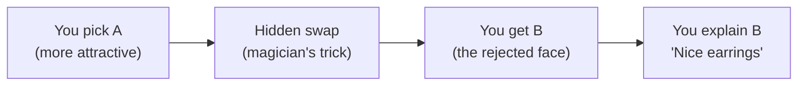

# Psychology · Day 6 of 7
## You defended a choice you never made: choice blindness

*About a 5-minute read. Answers to the recall questions are in the collapsible section at the bottom.*

---

**Lund University, Sweden, 2005.** A researcher sits across a table from you holding two photo cards, each showing a woman's face. *"Which one do you find more attractive?"* You point at the one on the left. Easy.

The researcher slides the cards face-down towards you, then hands you the one you picked. *"Could you tell me why you chose this one?"*

You look at it and start explaining. *"I like her smile. And the earrings, I've always liked earrings like that."*

There's one problem. **That's not the face you picked.** The researcher has a background in stage magic. With a quick sleight of hand, he handed you the *other* card. The woman you rejected. The woman you're now explaining your love of earrings to. (The one you actually picked wasn't wearing any.)

## The visual

**Swaps noticed: about 1 in 8.**

Across 120 people, only about **13%** of the swaps were caught as they happened. Most people sailed right past them, and then gave confident, detailed reasons for a choice they **never made**. The researchers called this **choice blindness**.

They didn't stop at faces:

- **In a supermarket:** shoppers tasted two jams (or two teas) and picked their favourite. When they were secretly given the one they'd rejected, even with flavours as different as cinnamon-apple and bitter grapefruit, **most didn't notice** and happily described why they liked it.
- **In a political survey:** people rated their agreement with moral and political statements. Some answers were secretly flipped to the opposite position. Most people defended at least one reversed answer, arguing *for* a view they had just rated *against*.

## The brain's "press secretary"

Something similar shows up in **split-brain patients**, people whose two brain halves were surgically separated to treat severe epilepsy. In a famous test, the non-talking half of one patient's brain was shown a **snowy scene**, and his left hand picked a **shovel**. The talking half had only seen a **chicken claw**, and had no idea about the snow. Asked why he chose the shovel, he didn't say "I don't know." He instantly said: *"Oh, you need a shovel to clean out the chicken shed."*

The neuroscientist Michael Gazzaniga called this the brain's **interpreter**: a part of us that always produces a reason, even when it has no access to the real one.

## What this means

We feel like we choose first and explain second, with the explanation being a report of what really happened. Often it's the other way round. The explanation is a **story built afterwards**, and it feels exactly like the truth. That's not lying; you genuinely believe it.

**The manipulation lens:** if people will defend a choice they didn't make, then whoever controls what you *think* you chose (a pre-ticked box, a "you said you wanted this" from a salesperson, a rewritten version of events from a manipulative partner) can steer what you'll defend next.

**Did it hold up?** Yes. Choice blindness has been replicated many times with faces, tastes, smells, political views and even eyewitness line-ups. The split-brain findings are classic, though modern research shows the two halves share more than first thought.

## Try it today

- **On yourself:** at dinner tonight, before you pick what to eat, write down your choice *and* your reason on paper, and fold it. Tomorrow, without looking, write down again what you chose and why. Compare the two. Did your reason change?
- **With others:** ask a friend (who knows it's a mini psychology game) to rate 5 statements from 1 to 10, like "Pineapple belongs on pizza" or "Mornings are better than nights." While "copying their answers onto a summary," flip one number (8 becomes 3). Show them the summary and ask them to explain *that* answer. Do they defend it? Reveal the swap **straight away** and have a laugh about it.

## Quick recall: Day 5

1. On the shaky Capilano bridge, about what share of men called the interviewer, compared with the solid bridge?
2. What's the name for crediting your racing heart to the wrong cause?
3. What simple trick reduces the strength of an emotion?

Answers

1. About half (9 of 18) vs about 1 in 8 (2 of 16).
2. Misattribution of arousal.
3. Affect labelling: naming the feeling ("I'm anxious").

---

**Next (final day):** a stranger buys you a free Coke, and you end up buying his raffle tickets. Plus a quick recap of the whole week.
